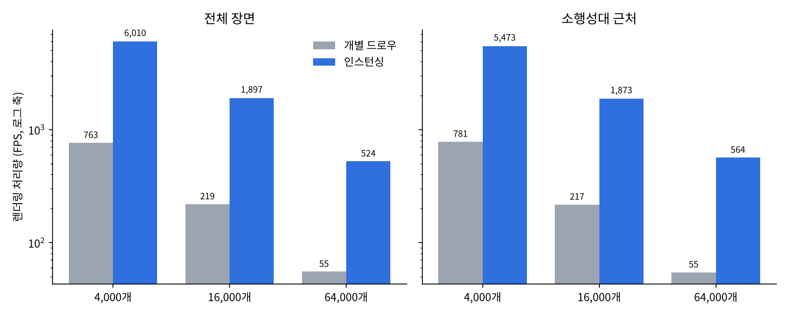
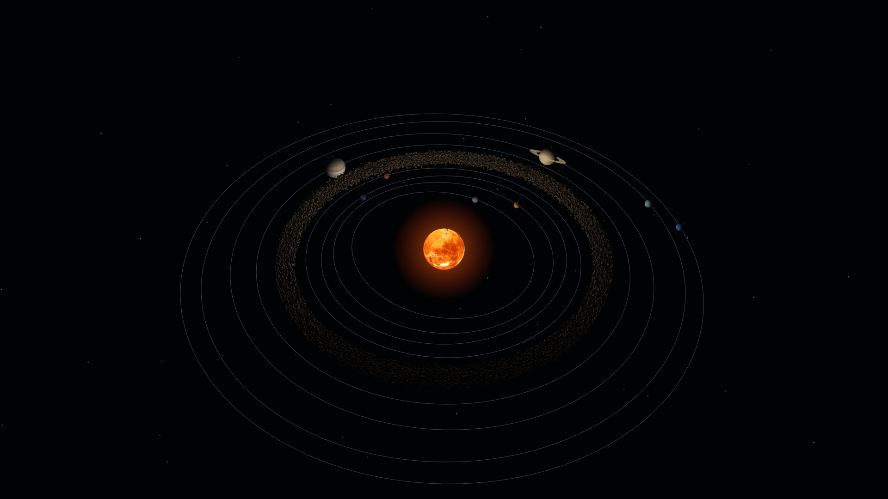
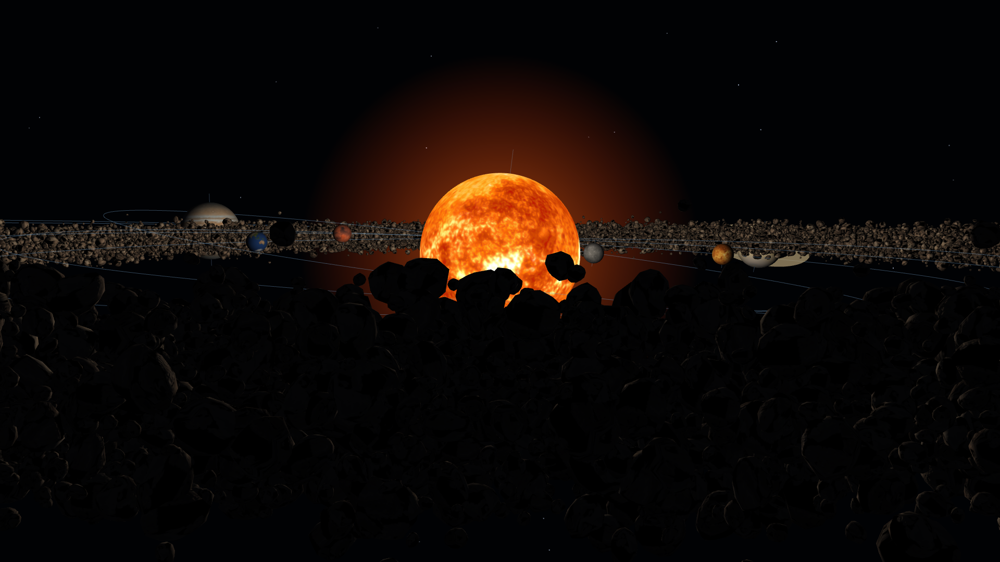

# 소행성 인스턴싱 비교 실측

측정: 2026-11-20 02:00 +09:00.

같은 장면에서 소행성을 그리는 방식만 바꿔, 드로우 콜을 합치는 효과를 비교한 실험입니다.

## 측정 조건

- CPU: AMD Ryzen 9 7945HX with Radeon Graphics. GPU: NVIDIA GeForce RTX 4060 Laptop GPU, OpenGL 4.6.
- MSVC x64, C++20, `/O2 /DNDEBUG`, 1920×1080, 4x MSAA 오프스크린 프레임버퍼. VSync와 화면 표시는 포함하지 않습니다.
- 소행성 메시: 드로우 콜 비용을 분리해 보기 위해 저폴리 바위(정점 42개, 삼각형 80개)를 사용했습니다. 원거리 LOD에 해당하는 수준입니다.
- 소행성 수: 4,000, 16,000, 64,000개. 텍스처, 셰이더, 개체별 데이터, 카메라와 시뮬레이션 시간은 같게 고정했습니다.
- 개별 드로우: 소행성마다 `glVertexAttrib4fv` 3회와 `glDrawElements` 1회. 인스턴싱: `glDrawElementsInstanced` 1회.
- 조건마다 0.5초 예열, 1.5초 측정을 2회 반복했고 반복마다 두 방식의 순서를 바꿨습니다.
- GPU 시간은 `GL_TIMESTAMP` 쿼리, CPU 시간은 소행성 드로우 함수가 반환될 때까지의 호출 스레드 시간입니다. 드라이버가 반환 이후에 처리하는 작업은 CPU 시간에 포함되지 않습니다.
- FPS는 총 완료 프레임 수를 총 경과 시간으로 나눈 렌더링 처리량입니다.

## 결과



| 소행성 수 | 시점 | 개별 드로우 FPS | 인스턴싱 FPS | 향상 | CPU 제출 시간 (개별 → 인스턴싱) |
|---:|---|---:|---:|---:|---|
| 4,000 | 전체 장면 | 763.5 | 6,009.6 | 7.9배 | 1.30ms → 0.07µs |
| 4,000 | 소행성대 근처 | 781.5 | 5,472.7 | 7.0배 | 1.27ms → 0.08µs |
| 16,000 | 전체 장면 | 219.0 | 1,897.1 | 8.7배 | 4.55ms → 0.13µs |
| 16,000 | 소행성대 근처 | 217.3 | 1,872.8 | 8.6배 | 4.59ms → 0.10µs |
| 64,000 | 전체 장면 | 55.4 | 523.6 | 9.5배 | 18.03ms → 0.17µs |
| 64,000 | 소행성대 근처 | 54.6 | 564.5 | 10.3배 | 18.26ms → 0.17µs |

모든 조건에서 인스턴싱의 처리량이 높았습니다. 개별 드로우는 소행성 수에 비례해 CPU 제출 시간이 늘어 프레임 시간이 그만큼 길어졌고, 인스턴싱은 개수와 관계없이 드로우 호출 한 번으로 제출했습니다.

개별 드로우의 GPU 소행성 구간 시간은 CPU 제출 시간과 거의 같았습니다. GPU가 계산하느라 오래 걸린 것이 아니라 CPU가 보내는 명령을 기다린 시간이 포함된 것입니다. 인스턴싱에서는 같은 기하를 GPU가 한 번에 받아 처리하므로 구간 시간이 크게 줄었습니다.

| 소행성 수 | 시점 | GPU 소행성 구간 (개별) | GPU 소행성 구간 (인스턴싱) |
|---:|---|---:|---:|
| 4,000 | 전체 장면 | 1.036ms | 0.118ms |
| 4,000 | 소행성대 근처 | 1.002ms | 0.121ms |
| 16,000 | 전체 장면 | 4.269ms | 0.478ms |
| 16,000 | 소행성대 근처 | 4.298ms | 0.473ms |
| 64,000 | 전체 장면 | 17.824ms | 1.860ms |
| 64,000 | 소행성대 근처 | 18.053ms | 1.714ms |

## 반복 결과

| 소행성 수 | 시점 | 방식 | 1회 FPS | 2회 FPS |
|---:|---|---|---:|---:|
| 4,000 | 전체 장면 | 개별 드로우 | 762.9 | 764.0 |
| 4,000 | 전체 장면 | 인스턴싱 | 6,068.5 | 5,950.7 |
| 4,000 | 소행성대 근처 | 개별 드로우 | 782.1 | 780.9 |
| 4,000 | 소행성대 근처 | 인스턴싱 | 5,552.1 | 5,393.3 |
| 16,000 | 전체 장면 | 개별 드로우 | 220.4 | 217.6 |
| 16,000 | 전체 장면 | 인스턴싱 | 1,896.9 | 1,897.4 |
| 16,000 | 소행성대 근처 | 개별 드로우 | 216.6 | 218.0 |
| 16,000 | 소행성대 근처 | 인스턴싱 | 1,911.0 | 1,834.6 |
| 64,000 | 전체 장면 | 개별 드로우 | 55.6 | 55.1 |
| 64,000 | 전체 장면 | 인스턴싱 | 523.5 | 523.7 |
| 64,000 | 소행성대 근처 | 개별 드로우 | 55.1 | 54.2 |
| 64,000 | 소행성대 근처 | 인스턴싱 | 553.2 | 575.7 |

## 화면 검증

측정 전에 두 방식으로 같은 프레임을 그려 픽셀을 비교했습니다. 채널 차이는 최대 1/255로 반올림 수준이며, 이를 넘으면 측정을 중단합니다.

- 4,000개 · 전체 장면: 2,073,600픽셀 중 39픽셀 차이, 최대 채널 차이 1/255.
- 4,000개 · 소행성대 근처: 2,073,600픽셀 중 297픽셀 차이, 최대 채널 차이 1/255.
- 16,000개 · 전체 장면: 2,073,600픽셀 중 9픽셀 차이, 최대 채널 차이 1/255.
- 16,000개 · 소행성대 근처: 2,073,600픽셀 중 279픽셀 차이, 최대 채널 차이 1/255.
- 64,000개 · 전체 장면: 2,073,600픽셀 중 42픽셀 차이, 최대 채널 차이 1/255.
- 64,000개 · 소행성대 근처: 2,073,600픽셀 중 285픽셀 차이, 최대 채널 차이 1/255.





## 해석 범위

이 실험은 드로우 호출을 합치는 효과를 보기 위해, 소행성 하나의 GPU 처리 비용이 작은 저폴리 메시를 사용했습니다. 앱 본편의 고해상도 바위 메시처럼 소행성 하나의 정점 수가 많으면 GPU 처리 시간이 프레임을 결정하므로, 인스턴싱으로 CPU 제출 시간을 줄여도 FPS 차이는 작아질 수 있습니다.

측정 시간이 짧아 노트북의 전력·온도 상태에 따라 수치가 달라질 수 있습니다. 같은 조건의 두 반복은 FPS 기준 5% 이내로 일치했습니다.

## 재현

`run-benchmark.cmd`를 실행하면 빌드와 측정을 수행하고 원본을 `Results/`에 저장합니다. `summarize.py`는 원본으로부터 이 보고서와 `summary.json`, 차트를 생성합니다.

```powershell
.\build-run.ps1 -ProjectRoot C:\path\to\3D-Solar-System-Simulator -VcpkgRoot C:\vcpkg
python .\summarize.py
```

측정용 소스 SHA-256: `0b1b04b95bbec80a91b1220b4f6e62b9d49bbf4e881a9a6240eca5422bc93ef7`.
