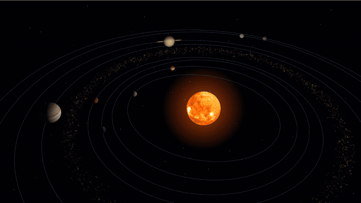
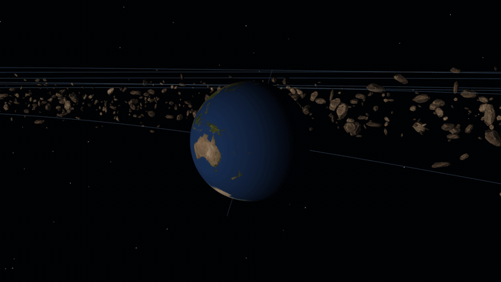
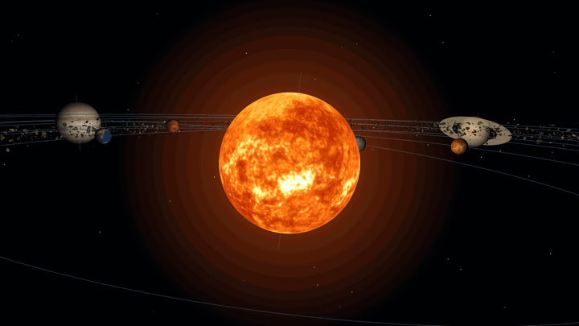
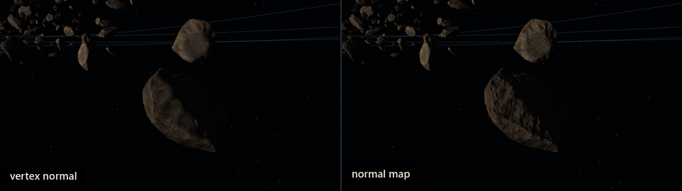
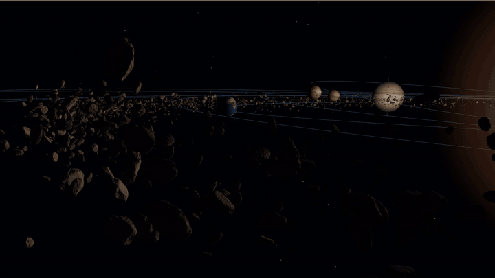

<div align="center">

# 3D Solar System Simulator

<p align="center"></p>

**OpenGL로 구현한 3D 태양계 텀프로젝트**


</div>

## Contents

- [프로젝트 소개](#프로젝트-소개)
- [셰이더와 조명](#셰이더와-조명)
- [깊이 처리와 블렌딩](#깊이-처리와-블렌딩)
- [노멀 매핑](#노멀-매핑)
- [인스턴싱](#인스턴싱)
- [회고](#회고)

<br>

## 프로젝트 소개

컴퓨터그래픽스 강의에서 배운 크기 조절·회전·이동(SRT)과 텍스처링을 실제 장면에 적용해 보기 위해 만든 프로젝트입니다. 같은 구 모양의 물체도 크기와 거리, 회전축과 속도를 달리하면 서로 다른 행성과 움직임으로 표현할 수 있습니다. 이 변환들을 연결해 태양과 여덟 행성의 자전·공전을 구성했습니다.

카메라를 움직이면 행성 표면, 토성 고리와 소행성대를 가까이 살펴볼 수 있습니다. 시간 진행 속도를 바꾸면 같은 장면에서 자전과 공전의 속도 차이도 관찰할 수 있습니다. 행성 사이의 거리는 로그 함수로 압축하고 작은 행성에는 최소 크기를 적용했으므로, 화면의 거리와 크기는 실제 태양계의 축척과 다릅니다.

수업에서 배운 내용으로 기본 장면을 만든 뒤, 표면을 밝히는 셰이더 조명과 깊이 처리·블렌딩을 적용했습니다. 소행성대에는 표면의 작은 요철을 표현하는 노멀 매핑과 같은 메시를 여러 개 그리는 인스턴싱을 사용했습니다. 구현은 [`main.cpp`](https://github.com/JuggernautSensei/3D-Solar-System-Simulator/blob/0a35574340bd9a171c0a023fb5215e7f9ac9faf1/main.cpp)에 모여 있습니다.

### 변환과 텍스처링

행성은 위도와 경도를 나누어 만든 하나의 구 메시를 공유합니다. 이 구에 행성마다 다른 크기, 위치와 회전을 적용하고 표면 이미지를 입혔습니다. 구를 한 번만 만들어도 모델 행렬과 텍스처를 바꾸면 태양부터 해왕성까지 표현할 수 있습니다.

공전과 자전은 모두 회전이지만 회전 중심이 다릅니다. 자전은 구를 자기 중심에서 회전시킨 뒤 궤도 위치로 옮기고, 공전은 그 위치까지 포함해 태양을 중심으로 회전시켜야 합니다. 그래서 행렬을 곱하는 순서가 움직임을 결정합니다. [`Display()`](https://github.com/JuggernautSensei/3D-Solar-System-Simulator/blob/0a35574340bd9a171c0a023fb5215e7f9ac9faf1/main.cpp#L1156)에서는 다음처럼 변환을 합성합니다.

```cpp
const Mat4 model = RotateZ(-planet.revolutionTilt)             // 궤도면 기울기
                 * RotateY(planet.revolutionSpeed * g_days)    // 태양을 중심으로 공전
                 * Translate({ distance, 0.f, 0.f })           // 궤도 위치로 이동
                 * RotateZ(-planet.rotationTilt)               // 자전축 기울기
                 * RotateY(planet.rotationSpeed * g_days);     // 행성 중심에서 자전
```

정점에는 오른쪽 행렬부터 적용됩니다. 구의 크기를 정하는 `Scale(radius)`는 이 모델 행렬 오른쪽에 곱합니다. 카메라의 뷰 행렬과 원근 투영 행렬까지 곱하면, 구의 로컬 좌표가 최종 화면을 그리는 데 필요한 좌표로 바뀝니다. 벡터와 행렬 연산, `LookAt()`과 `Perspective()`도 코드에 직접 구현했습니다.

텍스처 좌표는 구를 만들 때 경도와 위도를 각각 U와 V에 대응시켰습니다. 경도 한 바퀴가 끝나는 지점은 위치가 같아도 U가 0인 정점과 1인 정점을 따로 둡니다. 그래야 텍스처의 양 끝이 만나는 이음매에서 좌표가 구의 반대편까지 보간되지 않습니다. 이미지는 stb_image로 읽고, 축소해서 볼 때는 밉맵과 트라이리니어 필터링을 사용합니다.

<br>

## 셰이더와 조명

행성의 표면 무늬는 텍스처로 표현했습니다. 여기에 태양 방향에 따른 밝기를 더하려면 표면이 어느 쪽을 향하는지도 알아야 합니다. 그래서 표면의 법선과 빛의 방향으로 밝기를 계산하는 셰이더를 작성했습니다.

<p align="center"></p>

지구가 자전해도 밝은 쪽은 태양을 향합니다. 텍스처의 위치와 조명으로 정해지는 밝기를 따로 계산한 결과입니다.

### 정점 변환과 픽셀 계산

계산은 정점 셰이더와 프래그먼트 셰이더로 나눴습니다. 정점 셰이더는 위치를 월드 공간으로 바꾸고, 조명에 사용할 법선과 UV를 함께 넘깁니다. 프래그먼트 셰이더는 삼각형 내부에서 보간된 값을 받아 텍스처를 읽고 각 픽셀의 색을 계산합니다.

```glsl
vec4 worldPosition = uModel * vec4(aPosition, 1.0);
vWorldPosition     = worldPosition.xyz;
vNormal            = mat3(uModel) * aPosition;
vTexCoord          = aTexCoord;
gl_Position        = uViewProjection * worldPosition;
```

행성 메시는 원점 중심의 단위 구이므로 정점 위치가 곧 표면 법선의 방향입니다. 행성에는 회전과 균일한 크기 조절만 적용하므로, 법선도 모델 행렬의 3×3 부분으로 변환한 뒤 정규화해 사용합니다. 뒤에서 설명할 소행성은 축마다 크기가 달라 이 처리가 달라집니다.

### 램버트 조명

태양은 월드 원점에 있습니다. 따라서 표면에서 태양으로 향하는 방향은 `-vWorldPosition`입니다. 이 방향과 법선을 정규화해 내적하면, 표면이 빛을 얼마나 정면으로 받는지 알 수 있습니다. 아래는 [`kPlanetFragmentShader`](https://github.com/JuggernautSensei/3D-Solar-System-Simulator/blob/0a35574340bd9a171c0a023fb5215e7f9ac9faf1/main.cpp#L434)의 조명 계산입니다.

```glsl
float diffuse = max(dot(normalize(vNormal), normalize(-vWorldPosition)), 0.0);
oColor        = vec4(albedo.rgb * (kAmbient + kSunlight * diffuse), albedo.a);
```

표면이 빛을 정면으로 받으면 내적이 1에 가까워지고, 비스듬히 받으면 작아집니다. 빛의 반대편에서는 음수가 나오므로 0으로 제한합니다. 이것이 램버트 확산광입니다. 여기에 고정된 주변광을 더해 태양 반대쪽이 완전히 검게 사라지지 않게 했습니다. 태양 자체는 이 조명 계산을 거치지 않고 텍스처 색을 그대로 출력합니다.

이 조명은 표면 방향에 따른 밝기만 계산합니다. 거리에 따른 빛의 감쇠, 정반사와 다른 물체가 만드는 그림자는 구현하지 않았습니다. 따라서 밝고 어두운 면의 구분은 표현하지만, 물리적으로 정확한 태양광을 재현하는 모델은 아닙니다.

<br>

## 깊이 처리와 블렌딩

행성, 궤도선과 고리를 한 장면에 그리면 색을 계산하는 것만으로는 부족합니다. 가까운 물체가 먼 물체를 가려야 하고, 고리처럼 반투명한 물체는 이미 그려진 배경과 색을 섞어야 합니다. 이 두 역할을 깊이 버퍼와 블렌딩으로 나눴습니다.

한 프레임은 배경 별, 태양 광채, 소행성대 순으로 그립니다. 그다음 각 행성에 대해 궤도선, 자전축과 행성 표면을 그리고, 토성 차례에는 고리도 이어서 그립니다. 이 순서 안에서 대상에 맞게 깊이 쓰기와 블렌딩 상태를 바꿉니다.

### 깊이 검사와 깊이 쓰기

깊이 검사는 새로 그릴 픽셀이 깊이 버퍼에 기록된 값보다 가까운지 비교하는 과정입니다. 코드에서는 `GL_LEQUAL`을 사용해 깊이가 더 작거나 같을 때 통과시킵니다. 깊이 쓰기는 그 검사를 통과한 픽셀의 깊이를 버퍼에 남기는 동작입니다.

```cpp
glEnable(GL_DEPTH_TEST);
glDepthFunc(GL_LEQUAL);

glDepthMask(GL_FALSE);   // 깊이 검사는 유지하고, 깊이 기록만 끕니다.
```

[`Display()`](https://github.com/JuggernautSensei/3D-Solar-System-Simulator/blob/0a35574340bd9a171c0a023fb5215e7f9ac9faf1/main.cpp#L1156)에서는 배경 별과 태양 광채를 먼저 그리되 깊이를 기록하지 않습니다. 뒤에 그릴 행성이나 소행성이 이 효과의 깊이값에 막히지 않도록 하기 위해서입니다. 불투명한 소행성과 행성을 그릴 때는 다시 깊이 쓰기를 켜서 서로의 앞뒤 관계를 판정합니다.

궤도선도 깊이 쓰기를 끄고 그립니다. 이미 깊이가 기록된 물체와는 깊이를 비교하지만, 선 자체가 이후 물체의 깊이 판정에 영향을 주지는 않습니다. `glDepthMask(GL_FALSE)`를 호출해도 깊이 검사까지 꺼지는 것은 아니라는 점이 이 처리에서 중요합니다.

### 알파 블렌딩과 가산 블렌딩

<p align="center">
  
  
</p>

왼쪽은 배경과 색을 섞는 토성 고리, 오른쪽은 이미 그려진 색에 빛을 더하는 태양 광채입니다.

토성 고리에는 알파값 0.7을 주고 일반적인 알파 블렌딩을 사용했습니다.

```cpp
glBlendFunc(GL_SRC_ALPHA, GL_ONE_MINUS_SRC_ALPHA);
```

RGB 색을 기준으로 보면 새 색에 알파를 곱하고, 기존 색에는 `1 - 알파`를 곱해 더하는 방식입니다. 고리의 색과 이미 그려진 배경이 함께 보이게 됩니다.

태양 주변 광채에는 가산 블렌딩을 사용했습니다.

```cpp
glBlendFunc(GL_SRC_ALPHA, GL_ONE);
```

이 경우 기존 색은 그대로 두고 새 색에 알파를 곱한 값을 더합니다. 중심에서 멀어질수록 알파를 낮춰 빛이 옅어지게 했습니다. 같은 반투명 표현이라도 표면의 색을 섞는 고리와 빛을 더하는 광채에는 다른 블렌딩 식이 필요했습니다.

현재 반투명 렌더링에는 한계가 있습니다. 행성 순서대로 그리면서 토성 고리도 깊이를 기록하고, 반투명 물체를 카메라에서 먼 순서로 정렬하지 않습니다. 따라서 고리 뒤쪽 물체가 나중에 그려지면 깊이 검사에서 탈락해 고리 너머로 보이지 않을 수 있습니다. 블렌딩 식을 설정하는 것에 더해 그리는 순서와 깊이 쓰기도 함께 다뤄야 하는 부분입니다.

<br>

## 노멀 매핑

소행성에는 외부 바위 모델을 사용했습니다. 행성처럼 매끈한 구와 달리 바위 표면에는 작은 요철이 있습니다. 이 요철을 모두 삼각형으로 만들면 메시가 복잡해지므로, 표면의 법선 방향을 텍스처에서 읽어 조명 계산에 사용하는 노멀 매핑을 적용했습니다.

<p align="center"></p>

왼쪽은 메시의 정점 법선만 사용하고 오른쪽은 노멀 맵을 적용한 화면입니다. 두 바위의 기하 형태는 같습니다. 노멀 매핑은 실제 정점을 움직이지 않으므로 외곽선은 바뀌지 않고, 표면 내부에서 빛을 받는 방향이 달라져 요철이 있는 것처럼 보입니다.

### 탄젠트 공간

색상 텍스처의 RGB가 색을 저장한다면, 노멀 맵의 RGB는 표면을 기준으로 한 법선 방향을 저장합니다. 이 방향은 모델이 놓인 월드 공간 기준이 아니라 표면의 UV 방향을 기준으로 한 탄젠트 공간의 값입니다. 따라서 행성 조명에 쓰던 월드 공간의 빛 방향과 바로 내적할 수 없습니다.

표면의 U 방향을 나타내는 탄젠트 T, V 방향을 나타내는 바이탄젠트 B, 표면 법선 N을 구해 좌표계를 만들었습니다. [`LoadObjMesh()`](https://github.com/JuggernautSensei/3D-Solar-System-Simulator/blob/0a35574340bd9a171c0a023fb5215e7f9ac9faf1/main.cpp#L911)는 OBJ에서 위치·UV·법선을 읽고, 각 삼각형의 변과 UV 차이로 T와 B를 계산합니다.

```cpp
const float area      = du1 * dv2 - du2 * dv1;
const Vec3  tangent   = (edge1 * dv2 - edge2 * dv1) * (1.f / area);
const Vec3  bitangent = (edge2 * du1 - edge1 * du2) * (1.f / area);
```

여기서 `edge1`, `edge2`는 삼각형의 두 변이고 `du`, `dv`는 각 변에 대응하는 UV 차이입니다. 같은 정점을 공유하는 삼각형의 탄젠트를 누적한 뒤 법선 성분을 제거하고 정규화합니다. 바이탄젠트 방향은 `cross(N, T)`와 실제 계산한 B의 방향을 비교해 부호로 저장합니다. 이렇게 하면 정점에는 탄젠트 xyz와 부호 하나만 추가하면 됩니다.

### 법선 변환과 조명

소행성은 같은 메시가 반복돼 보이는 것을 줄이기 위해 축마다 크기를 다르게 적용합니다. 이 비균일 스케일에서는 법선에 위치와 같은 변환을 그대로 적용하면 표면과 수직을 이루지 못합니다. 정점 셰이더에서 법선은 축별 크기로 나누고 회전시킵니다. 탄젠트는 표면 위 방향이므로 축별 크기를 곱한 뒤 회전시키고, 다시 법선에 수직이 되도록 보정합니다.

마지막으로 프래그먼트 셰이더에서 노멀 맵의 `[0, 1]` 값을 `[-1, 1]`로 바꾸고, T·B·N을 열로 둔 행렬을 곱해 월드 공간 법선으로 옮깁니다.

```glsl
vec3 normal = normalize(vTangentToWorld * (texture(uNormal, vTexCoord).xyz * 2.0 - 1.0));
```

이 법선을 사용하면 빛의 방향과 밝기를 계산하는 식은 앞의 램버트 조명과 같습니다. 표면 방향을 어디에서 가져오는지가 달라진 것입니다.

<br>

## 인스턴싱

소행성대를 만들어 보면서 물체 수를 늘리자 프레임 레이트가 크게 떨어졌습니다. 다른 게임에서는 이보다 많은 물체도 그리는데 어떤 방법을 쓰는지 찾아보다 인스턴싱을 알게 됐습니다. 같은 바위 메시를 반복해서 사용하는 소행성대에 적용해 볼 수 있겠다고 생각했습니다.

인스턴싱은 같은 메시를 여러 개 그릴 때 개체마다 다른 값만 따로 전달하고, 하나의 드로우 명령으로 여러 개체를 그리는 방식입니다. 메시를 공유하는 것에서 한 걸음 더 나아가 드로우 호출도 묶을 수 있습니다.

<p align="center"></p>

같은 바위 메시로 소행성 4,000개를 그린 장면입니다. 개체마다 궤도와 크기, 회전축을 달리했습니다.

### 인스턴스 데이터

소행성은 메시와 색상·노멀 텍스처를 공유합니다. 대신 궤도와 자전, 크기에 필요한 값을 개체마다 따로 생성했습니다. [`CreateAsteroidInstances()`](https://github.com/JuggernautSensei/3D-Solar-System-Simulator/blob/0a35574340bd9a171c0a023fb5215e7f9ac9faf1/main.cpp#L1047)에서 이 값을 세 개의 `vec4`로 묶습니다.

| 속성 | 저장하는 값 |
|---|---|
| `aOrbit` | 궤도 반지름, 높이, 초기 공전 각도, 공전 각속도 |
| `aSpin` | 자전축 xyz, 자전 각속도 |
| `aScale` | 축별 크기 xyz, 초기 자전 각도 |

개체당 float 12개, 48바이트이므로 4,000개에 필요한 인스턴스 데이터는 192,000바이트입니다. 시작할 때 한 번 생성해 올리고 매 프레임 다시 쓰지 않습니다. 궤도 반지름과 높이, 크기와 회전축을 달리해 같은 모델이 서로 다르게 보이도록 했습니다.

인스턴스 데이터는 VAO의 바인딩 슬롯 1에 연결했습니다. `glVertexArrayBindingDivisor(..., 1, 1)`은 이 슬롯의 속성을 정점마다 바꾸는 대신 인스턴스가 바뀔 때마다 다음 값으로 넘어가게 합니다. 따라서 한 바위를 구성하는 정점은 모두 같은 궤도·자전·크기 값을 읽습니다.

```cpp
glVertexArrayVertexBuffer(_mesh.vao, 1, _mesh.instanceBuffer, 0, 12 * sizeof(float));
glVertexArrayBindingDivisor(_mesh.vao, 1, 1);
```

정점 셰이더는 인스턴스 데이터와 경과 일수 `uDays`로 현재 위치와 자세를 계산합니다. `AxisAngle()`은 자전축과 각도로 회전 행렬을 만드는 함수입니다.

```glsl
mat3  rotation = AxisAngle(aSpin.xyz, aScale.w + aSpin.w * uDays);
float angle    = aOrbit.z + aOrbit.w * uDays;
vec3  center   = vec3(aOrbit.x * cos(angle), aOrbit.y, -aOrbit.x * sin(angle));

vWorldPosition = center + rotation * (aPosition * aScale.xyz);
```

현재 구현에서는 CPU에서 소행성 4,000개의 모델 행렬을 매 프레임 만들 필요 없이, 움직임에 필요한 시간값을 보내고 `glDrawElementsInstanced`를 한 번 호출합니다. 카메라 변환과 텍스처를 설정하는 작업은 별도로 수행합니다. 아래 비교 실험에서는 개별 드로우 쪽도 같은 셰이더에서 움직임을 계산하도록 맞췄기 때문에, CPU 행렬 계산을 셰이더로 옮기는 효과까지 측정한 것은 아닙니다.

### 드로우 방식 비교

적용 당시의 FPS 기록은 남아 있지 않아 당시의 개선 여부와 폭은 확인할 수 없습니다. 아래 수치는 **현재 구현에서 드로우 방식만 바꿔 재현한 비교 실험**입니다. 소행성마다 속성을 설정하고 `glDrawElements`를 4,000번 호출하는 방식과, 인스턴스 속성 배열을 사용해 `glDrawElementsInstanced`를 한 번 호출하는 방식을 비교했습니다.

메시, 텍스처와 셰이더는 같게 두고 카메라와 시뮬레이션 시간도 고정했습니다. 전체 장면을 보는 시점과 소행성대 근처의 시점에서 각각 3초 예열 후 8초 이상 측정했고, 방식의 실행 순서를 바꾸며 세 번 반복했습니다. CPU 시간은 소행성 드로우 함수가 반환될 때까지, GPU 시간은 같은 구간에 넣은 타임스탬프 쿼리로 측정했습니다.

| 시점 | 소행성 드로우 방식 | CPU 구간 | GPU 구간 | FPS |
|---|---|---:|---:|---:|
| 전체 장면 | 개별 드로우 4,000회 | 3.8381ms | 12.463ms | 79.66 |
| 전체 장면 | 인스턴싱 1회 | 0.0013ms | 12.703ms | 78.20 |
| 소행성대 근처 | 개별 드로우 4,000회 | 6.1572ms | 9.451ms | 104.88 |
| 소행성대 근처 | 인스턴싱 1회 | 0.0018ms | 10.290ms | 96.40 |

> [!NOTE]
> 2026-10-18 측정. AMD Ryzen 9 7945HX, NVIDIA GeForce RTX 4060 Laptop GPU, 드라이버 617.14, MSVC x64 최적화 빌드(`/O2`), 1920×1080, 4x MSAA. FPS는 화면 출력 대기를 제외한 오프스크린 렌더링 처리량입니다. 구간 시간은 모든 측정 프레임의 평균이고, FPS는 세 번의 총 프레임 수를 총 경과 시간으로 나눴습니다.

CPU의 드로우 호출 구간은 크게 짧아졌습니다. 다만 이 시간은 호출 스레드에서 관찰한 값이고 드라이버 내부 작업 전체를 뜻하지는 않습니다. 개별 드로우 구간에는 드라이버 대기가 포함될 수 있으므로, 숫자의 비율을 그대로 CPU 연산량의 개선 배율로 해석하지 않았습니다.

GPU 구간 시간은 줄지 않았고 FPS도 높아지지 않았습니다. 드로우 호출을 묶어도 같은 소행성 4,000개의 기하와 셰이더를 처리한다는 점은 그대로입니다. 이번 실험에서 확인한 효과는 CPU의 드로우 제출 구간을 줄인 것이며, 프레임 레이트 개선까지 확인한 결과는 아닙니다.

실행 간 편차도 있었습니다. 전체 장면의 인스턴싱 결과는 반복별로 67.13~94.82FPS였고, 개별 드로우는 74.57~89.03FPS였습니다. 노트북의 전력·온도와 다른 프로그램의 부하를 완전히 통제한 실험은 아니므로 작은 차이의 원인은 단정하지 않았습니다.

본문에는 비교 방법과 평균값, 해석을 남겼습니다. 카메라 좌표와 반복별 결과, 프레임별 원본 및 실행 스크립트는 [측정 보고서](Docs/InstancingBenchmark/measurement-report.md)에서 확인할 수 있습니다.

<br>

## 회고

수업에서 배운 변환과 텍스처링을 실제로 움직이는 태양계에 적용하면서, 개별 연산이 한 장면 안에서 어떻게 연결되는지 확인할 수 있었습니다. 같은 구 메시도 변환을 합성하는 순서와 텍스처를 달리하면 서로 다른 행성이 됩니다. 공전과 자전을 함께 표현하는 과정은 행렬 곱셈을 화면의 움직임과 연결해 보는 기회였습니다.

그 위에 조명과 깊이 처리, 블렌딩을 더하면서 표면의 색과 방향, 물체의 가림 관계를 나누어 다뤘습니다. 특히 노멀 매핑에서는 텍스처에서 읽은 방향을 그대로 쓰는 것이 아니라, 빛의 방향과 같은 좌표 공간으로 옮겨야 조명을 계산할 수 있었습니다. 표면에 무늬를 입히는 텍스처링에서 출발해 표면의 방향까지 텍스처로 표현하는 데로 범위를 넓혔습니다.

소행성대를 그리면서 찾아 적용한 인스턴싱은 측정 결과를 해석하는 계기도 됐습니다. 이번 비교에서는 CPU의 드로우 제출 구간이 줄었지만 FPS 향상으로 이어지지는 않았습니다. 드로우 호출을 합친 효과와 GPU가 장면을 처리하는 비용을 구분해 볼 수 있었고, 기법을 적용했다는 사실만으로 전체 성능이 좋아졌다고 판단할 수 없다는 점을 확인했습니다.
