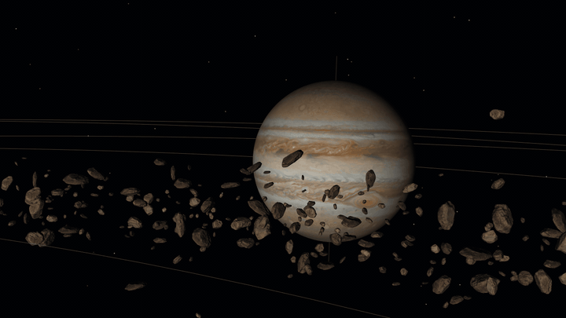

<div align="center">

# 3D Solar System Simulator

**OpenGL 4.6 Core 프로필로 구현한 실시간 태양계 렌더러**


</div>

<p align="center"></p>

<br>

## 개요

Win32 API로 창과 OpenGL 4.6 Core 컨텍스트를 만들고, GLSL 460 셰이더로 태양과 행성 8개, 소행성 4,000개를 그린다. 버퍼·텍스처·VAO는 모두 DSA(Direct State Access) 함수로 만들고, 행렬 연산은 외부 수학 라이브러리 없이 직접 구현했다. 전체 코드는 [`main.cpp`](main.cpp) 한 파일이다.

다룬 기술은 다음과 같다.

- WGL 확장을 이용한 Core 프로필 컨텍스트와 멀티샘플 픽셀 포맷 생성
- DSA 기반 불변(immutable) 버퍼·텍스처와 VAO 구성
- 열 우선 행렬로 구성한 모델·뷰·투영 변환
- 텍스처 매핑과 밉맵, 픽셀 단위 램버트 조명
- OBJ 로딩, 탄젠트 공간 계산, 노멀 매핑
- 인스턴스 버퍼와 정점 셰이더 애니메이션을 이용한 인스턴싱
- 가산 블렌딩 빌보드, 알파 블렌딩, 깊이 쓰기 제어

<br>

## 1. 컨텍스트 생성

Core 프로필 컨텍스트는 `wglCreateContextAttribsARB`로 만든다. 이 함수와 멀티샘플 포맷을 고르는 `wglChoosePixelFormatARB`는 확장 함수라서, 주소를 얻으려면 현재 스레드에 OpenGL 컨텍스트가 이미 연결되어 있어야 한다. 그래서 컨텍스트를 두 번 만든다.

1. 1×1 크기의 숨은 창에 `ChoosePixelFormat` + `wglCreateContext`로 레거시 컨텍스트를 만든다.
2. `glewInit()`으로 WGL 확장 함수 포인터를 불러온다. `WGL_ARB_pixel_format`, `WGL_ARB_create_context`, `WGL_ARB_create_context_profile`이 없으면 종료한다.
3. 임시 창과 컨텍스트를 지운다. 창 하나의 픽셀 포맷은 한 번만 지정할 수 있으므로 임시 창은 재사용하지 않는다.
4. 실제 창에서 `wglChoosePixelFormatARB`로 4x MSAA 포맷을 고른다. 없으면 샘플 수 0으로 다시 고른다.
5. 4.6 Core 컨텍스트를 만들고, `glewExperimental = GL_TRUE`로 GLEW를 다시 초기화한다.

```cpp
const std::array contextAttributes = {
    WGL_CONTEXT_MAJOR_VERSION_ARB, 4,
    WGL_CONTEXT_MINOR_VERSION_ARB, 6,
    WGL_CONTEXT_PROFILE_MASK_ARB,  WGL_CONTEXT_CORE_PROFILE_BIT_ARB,
    WGL_CONTEXT_FLAGS_ARB,         kContextFlags,   // Debug 빌드: WGL_CONTEXT_DEBUG_BIT_ARB
    0
};
g_hGLRC = wglCreateContextAttribsARB(g_hDC, nullptr, contextAttributes.data());
```

Core 프로필에서는 `glewInit()`이 오류 플래그(`GL_INVALID_ENUM`)를 남기는 경우가 있어서, 초기화 직후 `glGetError()`로 비운다. Debug 빌드에서는 `GL_DEBUG_OUTPUT_SYNCHRONOUS`를 켜고 `glDebugMessageCallback`을 등록해, 드라이버 메시지가 오류를 낸 호출 직후 콘솔에 출력되게 했다.

<br>

## 2. 프레임 구성

[`Display()`](main.cpp)는 한 프레임을 다음 순서로 그린다.

| 순서 | 대상 | 프로그램 | 깊이 쓰기 | 블렌딩 | 드로우 |
|---|---|---|:---:|---|---|
| 1 | 별 900개 | star | 끔 | `SRC_ALPHA, ONE_MINUS_SRC_ALPHA` | `GL_POINTS` |
| 2 | 태양 광채 | glow | 끔 | `SRC_ALPHA, ONE` (가산) | 사각형 1개 |
| 3 | 소행성 4,000개 | asteroid | 켬 | 불투명 | `glDrawElementsInstanced` 1회 |
| 4 | 행성 궤도선 | color | 끔 | 알파 | `GL_LINE_LOOP` |
| 5 | 행성 자전축 | color | 켬 | 알파 | `GL_LINES` |
| 6 | 행성 구 | planet | 켬 | 불투명 | `glDrawElements` |
| 7 | 토성 고리 | color | 켬 | 알파 0.7 | `GL_TRIANGLE_STRIP` |

4~7은 행성마다 반복한다. 깊이 검사는 모든 단계에서 켜 두고(`GL_LEQUAL`), 깊이 쓰기만 단계별로 바꾼다.

별은 정점 셰이더에서 카메라 위치를 더해 그린다(`uCameraPosition + aStar.xyz`). 카메라가 어디로 이동해도 별과의 상대 위치가 같아서 배경처럼 보이고, 깊이 버퍼에 쓰지 않으므로 다른 물체를 가리지 않는다. 궤도선은 반투명이라 깊이를 쓰면 뒤에 있는 행성이 가려진다. 깊이 검사만 하고 쓰지 않으면, 행성 앞을 지나는 선은 행성에 가려지고 뒤를 지나는 선은 행성을 가리지 않는다.

<br>

## 3. 버퍼와 정점 입력

### DSA로 메시 만들기

모든 메시는 [`CreateMesh()`](main.cpp) 하나로 만든다. 정점 배열과 속성별 성분 수 목록을 받아 버퍼와 VAO를 구성한다. 객체를 바인딩하지 않고 이름으로 직접 다루므로, 바인딩 상태가 함수 사이에 새어 나가지 않는다.

```cpp
glCreateBuffers(1, &mesh.vbo);
glNamedBufferStorage(mesh.vbo, size, data, 0);                     // 불변 스토리지, 갱신 플래그 없음

glCreateVertexArrays(1, &mesh.vao);
glVertexArrayVertexBuffer(mesh.vao, 0, mesh.vbo, 0, stride);       // 바인딩 슬롯 0
for (const GLint size: _attributeSizes)
{
    glEnableVertexArrayAttrib(mesh.vao, location);
    glVertexArrayAttribFormat(mesh.vao, location, size, GL_FLOAT, GL_FALSE, offset);
    glVertexArrayAttribBinding(mesh.vao, location, 0);
    ++location;
    offset += size * sizeof(float);
}
```

정점 데이터는 시작할 때 한 번 올리고 바꾸지 않으므로 `glNamedBufferStorage`의 플래그를 0으로 둔다. 인덱스 버퍼가 있으면 `glVertexArrayElementBuffer`로 VAO에 연결한다.

| 메시 | 프리미티브 | 정점 속성 | 크기 |
|---|---|---|---|
| 구 | `GL_TRIANGLES` (인덱스) | 위치 3 + UV 2 | 정점 10,201개, 인덱스 60,000개 (100×100 분할) |
| 고리 | `GL_TRIANGLE_STRIP` | 위치 3 | 202개 (안쪽 1.35, 바깥 2.2) |
| 궤도 | `GL_LINE_LOOP` | 위치 3 | 256개 (단위 원) |
| 자전축 | `GL_LINES` | 위치 3 | 2개 |
| 별 | `GL_POINTS` | 위치 3 + 밝기 1 | 900개 |
| 광채 | `GL_TRIANGLE_STRIP` | 모서리 2 | 4개 |
| 바위 | `GL_TRIANGLES` (인덱스) | 위치 3 + 법선 3 + UV 2 + 탄젠트 4 | 삼각형 3,998개 |

구와 궤도, 고리는 크기 1로 한 번만 만들고, 크기는 모델 행렬의 `Scale()`로 바꾼다. 행성 9개가 같은 구 메시를 공유한다.

### 유니폼

유니폼 위치는 GLSL에서 `layout(location = N)`으로 고정하고, 값은 `glProgramUniform*`로 프로그램을 지정해 넣는다. 실행 중에 `glGetUniformLocation`을 호출하지 않고, 값을 넣기 위해 `glUseProgram`을 먼저 호출할 필요도 없다. 샘플러는 `layout(binding = N)`으로 텍스처 유닛을 고정하고 `glBindTextureUnit`으로 텍스처를 붙인다.

<br>

## 4. 변환

### 행렬

`Mat4`는 `std::array<float, 16>`을 열 우선(column-major)으로 저장해, `glProgramUniformMatrix4fv`에 `transpose = GL_FALSE`로 그대로 넘긴다. `Translate`, `Scale`, `RotateY`, `RotateZ`, `Perspective`, `LookAt`을 직접 구현했다. 투영은 수직 시야각 40도, near 0.1, far 1000이다.

### 행성 모델 행렬

```cpp
const Mat4 model = RotateZ(-planet.revolutionTilt)             // 궤도면 기울기
                 * RotateY(planet.revolutionSpeed * g_days)    // 공전
                 * Translate({ distance, 0.f, 0.f })           // 궤도 반지름
                 * RotateZ(-planet.rotationTilt)               // 자전축 기울기
                 * RotateY(planet.rotationSpeed * g_days);     // 자전
```

정점에는 오른쪽 행렬부터 적용된다. 원점에서 자전시킨 구를 자전축만큼 기울이고, 궤도 반지름만큼 옮긴 뒤 공전시킨다. 자전축 기울기를 이동보다 먼저 적용하므로 공전하는 동안 자전축 방향이 유지된다. 각 행렬은 매 프레임 경과 일수 `g_days`로부터 새로 계산하므로, 이전 프레임 값에 증분을 누적할 때 생기는 오차가 없다.

세계 좌표는 Y축이 위이고 궤도면은 XZ 평면이다. 실제 거리를 그대로 쓰면 해왕성(30AU)과 수성(0.4AU)이 75배 차이 나서 한 화면에 담기지 않으므로, 거리를 로그로 압축한다.

```cpp
float ToDisplayDistance(const float _distance)   // _distance = AU × 8
{
    return _distance > 0.f ? 5.f + std::log2(1.f + _distance) * 4.f : 0.f;
}
```

수성은 13.3, 지구는 17.7, 목성은 26.7, 해왕성은 36.7에 놓인다. 반지름은 지구를 0.1로 둔 실제 비율에 1.6을 곱하고 최솟값을 0.55로 제한한다.

### 뷰 행렬

카메라는 위치와 yaw, pitch만 가진다. 시선 방향은 `(sin yaw · cos pitch, sin pitch, -cos yaw · cos pitch)`이고, 위치와 시선 방향, 세계 위쪽 `(0, 1, 0)`으로 `LookAt`을 만든다. pitch는 ±89도로 제한해 시선이 위쪽 벡터와 평행해지지 않게 했다.

<br>

## 5. 셰이더와 조명

셰이더는 GLSL 460 문자열로 소스에 들어 있고, 시작할 때 프로그램 5개로 컴파일·링크한다. 실패하면 정보 로그를 출력하고 종료한다.

| 프로그램 | 정점 입력 | 유니폼 | 용도 |
|---|---|---|---|
| planet | 위치, UV | 모델, 뷰·투영, `uLit`, 텍스처 | 텍스처 + 램버트 조명 |
| asteroid | 위치, 법선, UV, 탄젠트 + 인스턴스 속성 3개 | 뷰·투영, `uDays`, 색·노멀 텍스처 | 인스턴싱 + 노멀 매핑 |
| color | 위치 | MVP, 색 | 궤도선, 자전축, 고리 |
| star | 위치·밝기 | 뷰·투영, 카메라 위치 | 배경 별 |
| glow | 모서리 | 뷰·투영, 카메라 오른쪽·위쪽, 반지름 | 태양 광채 빌보드 |

광원은 원점에 있는 태양 하나다. 조명은 픽셀 단위 램버트 확산광과 고정 주변광으로 계산한다.

```glsl
const vec3 kAmbient  = vec3(0.12, 0.14, 0.2) * 0.2;
const vec3 kSunlight = vec3(1.0, 0.94, 0.84) * 0.8;

float diffuse = max(dot(normalize(vNormal), normalize(-vWorldPosition)), 0.0);   // 광원 방향 = 원점 - 위치
oColor        = vec4(albedo.rgb * (kAmbient + kSunlight * diffuse), albedo.a);
```

행성 메시는 원점 중심의 단위 구라서 법선이 정점 위치와 같다. 정점 셰이더는 법선을 따로 받지 않고 `mat3(uModel) * aPosition`으로 계산한다. 모델 행렬이 회전과 균일 스케일로만 이루어져 있으므로 역전치 행렬 없이 정규화만 하면 된다. 태양은 `uLit = false`로 조명 계산을 건너뛰고 텍스처 색을 그대로 출력한다.

<p align="center">
  
  
</p>

<br>

## 6. 텍스처 매핑

이미지는 stb_image로 RGBA 4채널로 읽는다. 이미지 첫 행이 위쪽이고 OpenGL 텍스처 좌표는 아래쪽이 0이므로 `stbi_set_flip_vertically_on_load(true)`로 뒤집는다.

```cpp
const auto levels = static_cast<GLsizei>(std::bit_width(static_cast<unsigned>(std::max(width, height))));
glCreateTextures(GL_TEXTURE_2D, 1, &texture);
glTextureStorage2D(texture, levels, GL_RGBA8, width, height);       // 밉맵 단계까지 불변 할당
glTextureSubImage2D(texture, 0, 0, 0, width, height, GL_RGBA, GL_UNSIGNED_BYTE, pixels);
glGenerateTextureMipmap(texture);
glTextureParameteri(texture, GL_TEXTURE_MIN_FILTER, GL_LINEAR_MIPMAP_LINEAR);
```

밉맵 단계 수는 `floor(log2(max(w, h))) + 1`이고, `std::bit_width`가 이 값을 정수 연산으로 구한다. 축소 필터는 트라이리니어(`GL_LINEAR_MIPMAP_LINEAR`)다. 행성은 멀리서 몇 픽셀 크기로 보이는 경우가 많아서, 밉맵이 없으면 카메라가 움직일 때 표면 텍스처가 반짝인다.

구 메시의 UV는 경도·위도에서 바로 만든다. 경도 방향 분할 `i`, 위도 방향 분할 `j`에 대해 위치는 `(sin θ · sin ρ, cos ρ, -cos θ · sin ρ)`, UV는 `(1 - i/100, 1 - j/100)`이다. 경도 0과 360도에 해당하는 정점을 따로 두어(열 101개) 텍스처 이음매에서 UV가 1에서 0으로 넘어가며 생기는 보간 오류를 막는다.

<br>

## 7. 노멀 매핑

### OBJ 로딩

[`LoadObjMesh()`](main.cpp)는 `v`, `vt`, `vn`, `f` 줄을 읽는다. OBJ의 면은 정점을 `위치/UV/법선` 번호 조합으로 가리키는데, 같은 위치라도 UV나 법선이 다르면 GPU에서는 다른 정점이어야 한다. 그래서 `"38/1/1"` 같은 토큰 문자열을 키로 `unordered_map`에 넣고, 처음 나온 조합만 새 정점으로 만든다. 다각형 면은 첫 정점을 기준으로 삼각형 팬으로 나눈다. 번호가 범위를 벗어나거나 형식이 맞지 않으면 해당 토큰을 출력하고 로딩을 중단한다. 로딩이 끝나면 모든 위치를 가장 먼 정점까지의 거리로 나눠 반지름 1로 정규화한다.

### 탄젠트 계산

노멀 맵은 탄젠트 공간(표면 기준 좌표계)의 법선을 저장하므로, 정점마다 탄젠트 T와 바이탄젠트 B가 필요하다. OBJ에는 이 값이 없어 삼각형의 두 변 `e1`, `e2`와 UV 차이 `(Δu1, Δv1)`, `(Δu2, Δv2)`로 계산한다.

```cpp
const float area      = du1 * dv2 - du2 * dv1;
const Vec3  tangent   = (edge1 * dv2 - edge2 * dv1) * (1.f / area);
const Vec3  bitangent = (edge2 * du1 - edge1 * du2) * (1.f / area);
```

각 삼각형의 T, B를 꼭짓점 3개에 누적한 뒤, T를 그람-슈미트 방식으로 법선과 직교하게 만들고 정규화한다. B는 저장하지 않는다. `cross(N, T)`와 누적한 B의 방향이 같은지만 `handedness`(±1)로 저장하고, 셰이더에서 `cross(N, T) * handedness`로 복원한다. UV가 뒤집힌 영역에서도 B의 방향이 맞게 유지된다. 정점 하나는 위치 3 + 법선 3 + UV 2 + 탄젠트 4로 float 12개다.

### 셰이더

정점 셰이더는 T, B, N을 월드 공간으로 변환해 `mat3`로 넘기고, 프래그먼트 셰이더는 노멀 맵 값을 [-1, 1]로 펼쳐 이 행렬로 변환한다.

```glsl
// 정점 셰이더
vec3 normal    = normalize(rotation * (aNormal / aScale.xyz));
vec3 tangent   = normalize(rotation * (aTangent.xyz * aScale.xyz));
tangent        = normalize(tangent - dot(tangent, normal) * normal);
vec3 bitangent = cross(normal, tangent) * aTangent.w;
vTangentToWorld = mat3(tangent, bitangent, normal);

// 프래그먼트 셰이더
vec3 normal = normalize(vTangentToWorld * (texture(uNormal, vTexCoord).xyz * 2.0 - 1.0));
```

소행성은 축마다 크기가 다르게 늘어나므로, 법선은 크기를 곱하지 않고 나눈다. 비균일 스케일에서 위치와 같은 변환을 법선에 적용하면 표면과 수직이 아니게 되기 때문이고, 대각 스케일 행렬의 역전치를 곱하는 것과 같다. 탄젠트는 표면 위의 방향이므로 위치처럼 크기를 곱한다.

<p align="center"></p>

같은 바위를 같은 조건에서 그렸다. 왼쪽은 정점 법선만 쓴 것이고, 오른쪽은 노멀 맵을 적용한 것이다. 삼각형 3,998개로는 표현되지 않는 작은 요철이 노멀 맵으로 조명에 나타난다.

<br>

## 8. 인스턴싱

<p align="center"></p>

### 인스턴스 버퍼

소행성 4,000개는 같은 바위 메시를 쓰고, 개체마다 다른 값은 인스턴스 버퍼 하나에 담는다. 버퍼는 시작할 때 한 번 채우고(48바이트 × 4,000 = 192KB) 이후 갱신하지 않는다.

| location | 속성 | 내용 |
|:---:|---|---|
| 4 | `aOrbit` | 궤도 반지름, 높이, 초기 위상, 공전 각속도 |
| 5 | `aSpin` | 자전축 xyz, 자전 각속도 |
| 6 | `aScale` | 축별 크기 xyz, 초기 자전 각도 |

인스턴스 버퍼는 VAO의 바인딩 슬롯 1에 연결하고, 디바이저를 1로 두어 인스턴스마다 한 번씩 다음 값을 읽게 한다.

```cpp
glVertexArrayVertexBuffer(_mesh.vao, 1, _mesh.instanceBuffer, 0, 12 * sizeof(float));
glVertexArrayBindingDivisor(_mesh.vao, 1, 1);                       // 슬롯 1: 인스턴스 단위
for (GLuint i = 0; i < 3; ++i)
{
    glEnableVertexArrayAttrib(_mesh.vao, 4 + i);
    glVertexArrayAttribFormat(_mesh.vao, 4 + i, 4, GL_FLOAT, GL_FALSE, i * 4 * sizeof(float));
    glVertexArrayAttribBinding(_mesh.vao, 4 + i, 1);
}
```

### 절차적 배치

| 값 | 생성 방법 |
|---|---|
| 궤도 반지름 | 평균 2.7AU, 표준편차 0.3AU 정규분포, [2.1, 3.3]AU로 자른 뒤 `ToDisplayDistance()` |
| 공전 각속도 | 케플러 제3법칙, 2π / (365.26 · a<sup>1.5</sup>) rad/일 |
| 높이 | 표준편차 0.35 정규분포 |
| 자전 | 균등분포 축, 20~120도/일, 방향 무작위 |
| 크기 | 0.06 + 0.2 · u³ (u는 [0, 1] 균등분포) |
| 축별 비율 | 크기에 축마다 0.75~1.25배를 따로 곱함 |

시드는 고정(`std::mt19937 { 42 }`)이라 실행할 때마다 같은 소행성대가 만들어진다. 크기에 u³을 쓰면 작은 바위가 많고 큰 바위가 드문 분포가 된다. 축별 비율과 자전축이 달라서 같은 메시가 서로 다른 모양으로 보인다.

### 정점 셰이더 애니메이션

소행성의 위치와 자세는 정점 셰이더가 `uDays` 하나로 계산한다. CPU는 매 프레임 float 하나를 보내고 드로우 콜을 한 번 호출한다.

```glsl
mat3  rotation = AxisAngle(aSpin.xyz, aScale.w + aSpin.w * uDays);       // 로드리게스 회전 행렬
float angle    = aOrbit.z + aOrbit.w * uDays;
vec3  center   = vec3(aOrbit.x * cos(angle), aOrbit.y, -aOrbit.x * sin(angle));

vWorldPosition = center + rotation * (aPosition * aScale.xyz);
gl_Position    = uViewProjection * vec4(vWorldPosition, 1.0);
```

`AxisAngle()`은 임의 축 회전 행렬을 로드리게스 공식으로 만든다. 공전 방향은 행성의 `RotateY`와 같게 맞췄다.

### 성능 측정

드로우 방식만 바꾼 측정용 빌드로 소행성대를 그리는 구간의 시간을 쟀다. GPU 시간은 `GL_TIME_ELAPSED` 쿼리 4개를 순환하며 4프레임 전 결과를 읽었고, CPU 시간은 같은 구간의 GL 호출이 반환되기까지의 시간이다. 수직 동기화를 끄고 카메라를 고정한 상태에서 3초 예열 후 10초를 측정했고, 두 번 측정한 평균이다.

| 방식 | GPU (전경) | GPU (근경) | CPU (전경) | CPU (근경) |
|---|---:|---:|---:|---:|
| `glDrawElementsInstanced` 1회 | 7.75ms | 8.01ms | 0.03ms | 0.02ms |
| `glDrawElementsInstancedBaseInstance` 4,000회 | 7.77ms | 8.09ms | 0.11ms | 3.05ms |
| `glVertexAttrib4fv` 3회 + `glDrawElements`, 4,000회 | 7.12ms | 7.43ms | 0.36ms | 0.50ms |
| 인스턴싱 1회, 인덱스 1/8만 그림 | 0.98ms | 1.00ms | 0.004ms | 0.004ms |

세 번째 행은 인스턴스 속성 배열을 끄고 개체마다 CPU에서 속성 값을 넣는 방식으로, 인스턴싱을 쓰지 않을 때의 일반적인 구현에 해당한다. 마지막 행은 바위당 삼각형을 약 500개로 줄였을 때의 비용을 보기 위한 것이고 화면은 올바르지 않다.

- GPU 시간은 드로우 방식과 관계없이 7.1~8.1ms로 비슷하고, 삼각형 수를 1/8로 줄이면 0.98ms가 된다. 이 장면의 GPU 비용은 프레임당 삼각형 수(3,998 × 4,000 ≈ 1,600만 개)에 비례한다.
- 인스턴싱의 효과는 CPU 쪽에 나타난다. 개체마다 상태를 설정하는 방식(0.36~0.50ms)보다 10배 이상 짧다.
- 이 환경에서는 프레임 시간이 GPU에 묶여 있어 CPU 차이가 FPS 차이로 이어지지 않았다.
- 세 번째 방식의 GPU 시간이 0.6ms 짧은 이유와, `BaseInstance` 방식의 근경 CPU 시간이 크게 튄 이유는 확인하지 않았다. CPU 시간에는 드라이버 스레드의 작업이 포함되지 않는다.

> [!NOTE]
> AMD Ryzen 9 7945HX, NVIDIA GeForce RTX 4060 Laptop GPU (드라이버 32.0.16.1714), Windows 11, 1920×1080, 4x MSAA, Release 빌드. 측정용 빌드는 저장소에 포함하지 않았다.

<br>

## 9. 블렌딩

### 태양 광채 빌보드

광채는 카메라를 향하는 사각형 하나다. 뷰 행렬의 첫 두 행이 월드 공간에서 본 카메라의 오른쪽·위쪽 방향이므로, 이 두 벡터로 사각형의 모서리를 만든다.

```cpp
glProgramUniform3f(g_glowProgram, 1, view.m[0], view.m[4], view.m[8]);   // 카메라 오른쪽
glProgramUniform3f(g_glowProgram, 2, view.m[1], view.m[5], view.m[9]);   // 카메라 위쪽
```

```glsl
// 정점 셰이더: 모서리 (±1, ±1)을 카메라 평면에 펼침
gl_Position = uViewProjection * vec4((uCameraRight * aCorner.x + uCameraUp * aCorner.y) * uRadius, 1.0);

// 프래그먼트 셰이더: 중심에서 멀어질수록 투명
float falloff = length(vCorner);
if (falloff > 1.0) discard;
oColor = mix(vec4(1.0, 0.45, 0.08, 0.65), vec4(1.0, 0.2, 0.02, 0.0), falloff);
```

블렌딩은 `GL_SRC_ALPHA, GL_ONE`(가산)이다. 배경에 색을 더하기만 하므로 별과 겹치는 부분이 어두워지지 않는다. 깊이를 쓰지 않으므로 이후에 그리는 태양 구가 광채에 가려지지 않는다.

### 반투명 기하

토성 고리는 단색 알파 0.7, 궤도선과 자전축은 알파 0.3~0.45로 `GL_SRC_ALPHA, GL_ONE_MINUS_SRC_ALPHA` 블렌딩을 쓴다. 반투명 물체를 정렬하지 않고 행성 순서대로 그리기 때문에, 고리 뒤에 있는 물체가 고리보다 나중에 그려지면 깊이 검사에 걸려 고리 너머로 보이지 않는다.

<p align="center">
  
  
</p>

<br>

## 빌드 및 실행

필요한 환경은 Windows 10/11, Visual Studio 2026(C++ 데스크톱 개발 워크로드, v145 툴셋), vcpkg, OpenGL 4.6 지원 드라이버다. GLEW와 stb는 `vcpkg.json` 매니페스트로 첫 빌드 때 설치된다. vcpkg는 Visual Studio에 포함된 것을 쓰거나, 별도 설치 후 `vcpkg integrate install`을 실행한다.

1. `SolarSystem.sln`을 연다.
2. 구성을 `Release`, 플랫폼을 `x64`로 바꾼다.
3. Ctrl + F5로 실행한다.

빌드 후 `Resources` 폴더가 실행 파일 옆으로 복사되고, 텍스처와 모델은 실행 파일 기준 상대 경로로 읽는다. CMake를 쓸 때는 `VCPKG_ROOT` 환경 변수를 지정하고 다음을 실행한다.

```bash
cmake --preset x64-release
cmake --build Build/x64-release
```

조작은 마우스로 시점을 돌리고 W/A/S/D로 수평 이동, E/Q로 상하 이동, P/O로 이동 속도를 조절한다.

> [!TIP]
> 내장·외장 GPU가 함께 있는 노트북에서는 Windows 설정의 **시스템 > 디스플레이 > 그래픽**에서 `SolarSystem.exe`를 고성능 GPU로 지정한다.

<br>

## 한계

- 소행성대의 GPU 비용은 삼각형 수에 비례하지만, 거리별 LOD나 절두체 컬링이 없어 화면에서 1~2픽셀인 바위도 삼각형 3,998개를 모두 그린다.
- 바위 메시는 반지름만 정규화하고 중심을 원점으로 옮기지 않아서, 자전할 때 회전 중심이 메시 중심에서 약간 벗어난다.
- 조명은 확산광과 주변광뿐이며 정반사, 그림자, 대기 산란이 없다.
- 반투명 물체를 깊이 순으로 정렬하지 않는다.
- 반지름 최솟값 0.55 때문에 수성·금성·지구·화성이 같은 크기로 보인다.

<br>

## 고지

학습 목적의 프로젝트다. 행성 텍스처와 바위 모델(`Rock1.obj`, `tex_low_*`)의 저작권은 각 원작자에게 있다. 행성의 공전·자전 주기와 기울기는 [한국천문연구원 천문우주지식정보](https://astro.kasi.re.kr/learning/pageView/5116)를 참고했다.
