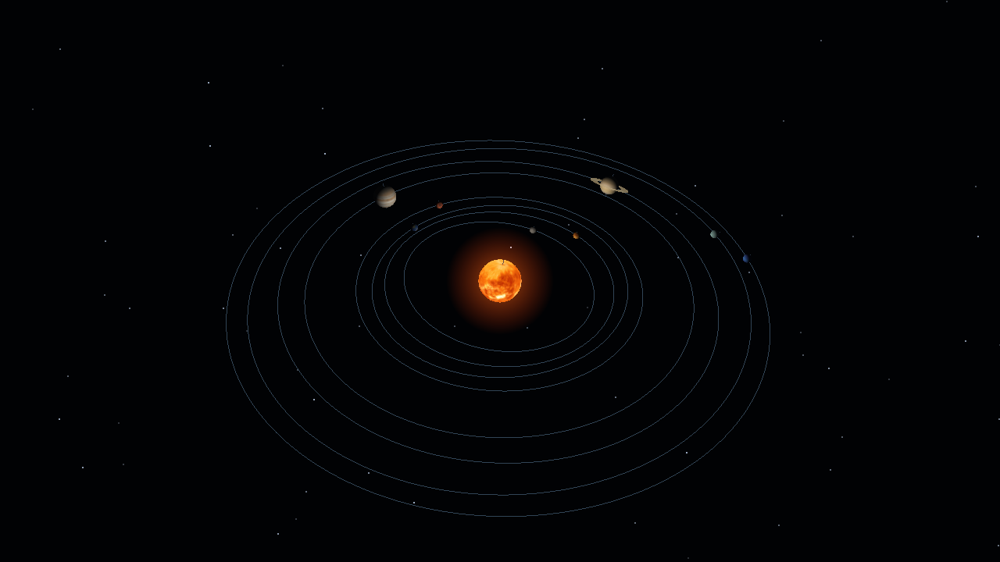
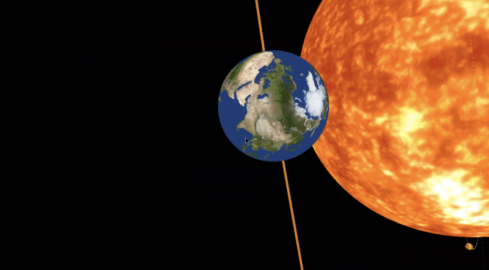

# 3D Solar System Simulator




## 프로젝트 소개

컴퓨터그래픽스 과목에서 수행한 태양계 렌더링 과제를 정리한 저장소입니다. 태양과 수성부터 해왕성까지의 행성을 구로 표현하고, 각 천체의 크기와 태양으로부터의 거리, 공전·자전 속도와 축 기울기를 데이터로 지정했습니다. 카메라를 직접 움직이며 전체 궤도와 행성 표면을 살펴볼 수 있습니다.

OpenGL 고정 기능 파이프라인과 GLU, GLUT 계열의 freeglut, 이미지 로딩 라이브러리 SOIL을 사용합니다. 셰이더나 별도의 렌더러 구조를 도입하지 않고, 과제의 데이터와 렌더링·입력·시간 갱신 코드를 [`main.cpp`](main.cpp) 하나에 두었습니다.

현재는 태양계 과제만 포함합니다. 위 이미지는 현재 코드로 렌더링한 화면입니다. 행성이 잘 보이도록 궤도 간격과 표시 크기를 조정하고, 별 배경과 태양 빛 번짐, 행성 명암, 토성 고리를 더했습니다. 실행 영상은 추후 촬영해 추가할 예정입니다.

## 과제에서 다룬 내용

| 구현 | 코드에서 사용하는 기능 | 핵심 개념 |
|---|---|---|
| 행성의 공전·자전 | `glRotatef`, `glTranslatef` | 변환 순서, 지역 좌표계, 행렬 합성 |
| 천체와 공전 궤도 | `gluSphere`, `GL_LINE_LOOP`, `gluDisk` | 구, 궤도선, 토성 고리 표현 |
| 행성 표면 | SOIL, `gluQuadricTexture`, `glBindTexture` | 이미지 로딩, 텍스처 좌표와 샘플링 |
| 자유 이동 카메라 | `gluLookAt`, `gluPerspective` | 시점 변환, 원근 투영, 화면 비율 |
| 프레임 갱신 | `QueryPerformanceCounter`, GLUT 콜백 | 경과 시간, 입력 처리, 애니메이션 |
| 화면 출력 | 깊이 테스트, 더블 버퍼링, 멀티샘플링 | 가시성 판정, 앞뒤 버퍼 교환, 가장자리 계단 현상 완화 |
| 시각 효과 | 점 광원, 알파 블렌딩 | 행성 명암, 태양 빛 번짐, 반투명 궤도선 |

## 주요 내용

### 1. 변환을 합성해 공전과 자전을 표현합니다

행성을 그릴 때는 공전축 기울기, 공전 각도, 태양으로부터의 거리, 자전축 기울기, 자전 각도 순으로 변환을 지정합니다. 공전 각도와 자전 각도는 각각의 각속도에 누적 시뮬레이션 날짜를 곱해 계산합니다.

```cpp
glRotatef(planet.revolutionTilt, 0.f, 1.f, 0.f);
glRotatef(planet.revolutionSpeed * g_days, 0.f, 0.f, 1.f);
glTranslatef(distance, 0.f, 0.f);
glRotatef(planet.rotationTilt, 0.f, 1.f, 0.f);
glRotatef(planet.rotationSpeed * g_days, 0.f, 0.f, 1.f);
```

고정 기능 OpenGL은 현재 행렬의 오른쪽에 새 변환을 곱합니다. 따라서 구의 정점에는 자전이 먼저 적용되고, 이동과 공전을 거쳐 태양 주위의 위치가 결정됩니다. 이동과 회전의 순서를 바꾸면 물체가 제자리에서 회전하는지, 원점 주위를 도는지가 달라집니다.

각 행성을 그리기 전후에 `glPushMatrix()`와 `glPopMatrix()`를 호출해 변환을 복원합니다. 앞서 그린 행성의 위치와 회전이 다음 행성에 누적되지 않도록 한 것입니다. 행성마다 공전 반지름에 맞춘 얇은 궤도와 자전축을 나타내는 선도 그립니다.

### 2. 같은 구에 서로 다른 표면을 입힙니다

천체의 형태는 `gluSphere()`로 만들고, BMP 이미지를 SOIL로 읽어 OpenGL 텍스처로 올립니다. 구에 텍스처 좌표를 생성하도록 `gluQuadricTexture()`를 설정한 뒤, 행성을 그릴 때 해당 텍스처를 바인딩합니다. 동일한 구 도형을 사용해도 이미지와 반지름을 바꾸면 서로 다른 천체를 표현할 수 있습니다.

확대 필터는 `GL_LINEAR`, 축소 필터는 밉맵을 사용하는 `GL_LINEAR_MIPMAP_LINEAR`, 반복 방식은 `GL_REPEAT`를 사용합니다. 작은 행성을 멀리서 볼 때는 축소된 텍스처를 사용해 표면 무늬의 깜빡임을 줄입니다. 궤도와 축선은 텍스처를 끄고 그려 행성 표면 이미지의 색이 섞이지 않도록 했습니다.

정리 과정에서 태양 위치에 점 광원을 두어 행성의 밝은 면과 어두운 면을 구분했습니다. 태양 자체는 조명을 끄고 그립니다. 태양 주변에는 카메라를 바라보는 원형 도형을 더하고, 중심에서 가장자리로 갈수록 투명하게 만들어 빛이 번지는 느낌을 냈습니다. 별은 시작할 때 생성한 900개의 점으로 표현하고, 카메라 위치를 따라 배치해 먼 배경처럼 보이게 했습니다.



### 3. 카메라 이동과 시뮬레이션 시간을 따로 조절합니다

카메라는 yaw와 pitch로 바라보는 방향을 계산합니다. `W`·`S`는 수평 시선 방향으로, `A`·`D`는 그에 수직인 방향으로 이동하고, 높이는 별도의 키로 바꿉니다. 마우스는 창 중앙에서 벗어난 거리를 회전량으로 사용합니다. 위아래 시선은 ±89도로 제한합니다.

실제 경과 시간은 `QueryPerformanceCounter()`로 측정합니다. 카메라 이동량에는 프레임 경과 시간을 곱하고, 시뮬레이션 날짜는 1/60초 간격으로 갱신합니다. 한 프레임에 여러 갱신 간격이 지났다면 누적된 만큼 처리합니다. 기본 설정은 갱신 한 번에 0.05일, 실제 1초에 시뮬레이션 3일입니다.

시작 화면에서 천체가 한 줄에 겹치지 않도록 시뮬레이션 날짜는 1600일부터 시작합니다. 카메라는 전체 궤도를 비스듬히 내려다보는 위치에 놓았습니다.

카메라 이동 속도와 날짜 진행 속도를 독립적으로 조절할 수 있어, 행성에 가까이 접근한 뒤 공전·자전만 빠르게 관찰할 수 있습니다. 창 제목에는 현재 이동 속도, 초당 날짜 진행량, 누적 날짜가 표시됩니다.

## 조작 방법

| 입력 | 동작 |
|---|---|
| `W` / `S` | 수평 시선 방향으로 전진 / 후진 |
| `A` / `D` | 왼쪽 / 오른쪽 이동 |
| `Space` / `왼쪽 Shift` | 상승 / 하강 |
| 마우스 이동 | 시선 회전 |
| `P` / `O` | 카메라 이동 속도 증가 / 감소 |
| `K` / `L` | 날짜 진행 속도 증가 / 감소 |
| `Esc` | 종료 |

속도 조절은 키를 누르고 있는 동안 적용됩니다. 날짜 진행 속도를 0까지 낮추면 천체의 움직임이 멈춥니다. 키보드 이동과 마우스 중앙 고정은 이 프로그램에 포커스가 있을 때 적용됩니다.

## 실행 방법

Windows의 Visual Studio 2022 17.6 이상(또는 Visual Studio 2026)이 필요합니다. Visual Studio Installer에서 **C++를 사용한 데스크톱 개발** 워크로드를 설치하고, 개별 구성 요소의 **vcpkg 패키지 관리자**가 선택되어 있는지 확인합니다. freeglut과 SOIL은 [`vcpkg.json`](vcpkg.json)에 지정되어 있으며, 빌드할 때 vcpkg가 자동으로 설치합니다.

### Visual Studio 솔루션

1. 처음 한 번만 **Developer PowerShell for VS**에서 vcpkg를 Visual Studio와 연결합니다.

   ```powershell
   vcpkg integrate install
   ```

2. 저장소 루트의 `SolarSystem.sln`을 엽니다.
3. 상단에서 `Debug` 또는 `Release`, `x64`를 고르고 `F5`로 빌드·실행합니다. 첫 빌드에서는 vcpkg가 freeglut과 SOIL을 내려받아 빌드하므로 시간이 걸립니다.

실행 파일은 `Bin/x64/<구성>/`에 생성되며, 빌드할 때 `Resources/`와 freeglut DLL이 그 옆에 복사됩니다.

### CMake 프리셋

개별 구성 요소의 **Windows용 C++ CMake 도구**가 추가로 필요합니다. 빌드 설정은 [`CMakePresets.json`](CMakePresets.json)에 있습니다.

Visual Studio에서 사용할 때는 다음 순서로 실행합니다.

1. **파일 → 열기 → 폴더**로 저장소 루트를 엽니다.
2. 상단 도구 모음의 구성 목록에서 `x64 Debug` 또는 `x64 Release`를 고릅니다.
3. 시작 항목에서 `SolarSystem.exe`를 고르고 `F5`(디버그) 또는 `Ctrl+F5`(디버그하지 않고 시작)로 실행합니다.

명령줄에서는 **Developer PowerShell for VS**를 열고 저장소 루트에서 다음을 실행합니다. 이 셸에는 MSVC 컴파일러와 Ninja, Visual Studio에 포함된 vcpkg의 경로(`VCPKG_ROOT`)가 설정되어 있습니다.

```powershell
cmake --preset x64-release
cmake --build --preset x64-release
Set-Location Build/x64-release
./SolarSystem.exe
```

별도로 설치한 vcpkg를 쓰려면 구성 전에 `$env:VCPKG_ROOT = "C:/vcpkg"`처럼 경로를 지정합니다. 빌드할 때 `Resources/`와 freeglut DLL이 실행 파일 옆(`Build/<프리셋 이름>/`)에 배치됩니다.

텍스처는 실행 시 작업 폴더의 `Resources/`에서 읽으므로, 실행 파일과 이 폴더를 함께 두어야 합니다.

## 저장소 구조

```text
3D-Solar-System-Simulator/
├── main.cpp
├── SolarSystem.sln
├── SolarSystem.vcxproj
├── CMakeLists.txt
├── CMakePresets.json
├── vcpkg.json
├── Resources/
│   └── 천체별 BMP 텍스처 9개
├── Result/
│   └── 현재 렌더링 화면과 기존 과제 실행 캡처
└── README.md
```

## 구현 범위와 한계

이 과제는 좌표 변환과 렌더링을 학습하기 위한 시각화입니다. 행성은 원 궤도를 일정한 각속도로 움직이며, 중력이나 타원 궤도를 계산하지 않습니다. 원본 데이터는 지구 반지름 0.1, 태양과 지구 사이 거리 8을 기준으로 하고, 태양 반지름은 지구의 30배로 줄인 값입니다.

현재 화면에서는 외행성까지 함께 볼 수 있도록 공전 반지름을 `5 + 4 × log₂(1 + 원본 거리)`로 압축했습니다. 행성의 표시 반지름은 원본의 1.6배로 하고 최소 0.55로 설정했으며, 태양의 표시 반지름은 3을 유지했습니다. 이 조정은 화면에서 작은 천체를 구분하기 위한 것이며, 실제 크기와 거리의 비율을 표현하지 않습니다.

천체 데이터와 텍스처는 기존 과제에서 사용한 값을 유지했습니다. 특히 외행성의 자전 속도는 원본 수치를 그대로 사용하므로 천문학적으로 정확한 시뮬레이터로 볼 수는 없습니다. 토성의 고리는 단순한 원환으로 표현했고, 위성이나 천체 사이에 드리워지는 그림자는 구현하지 않았습니다.
