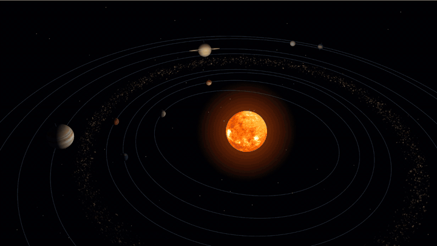
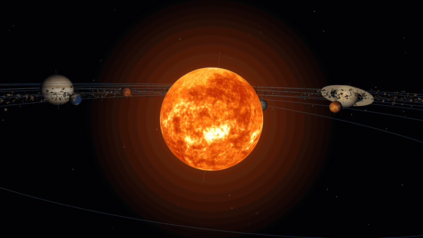
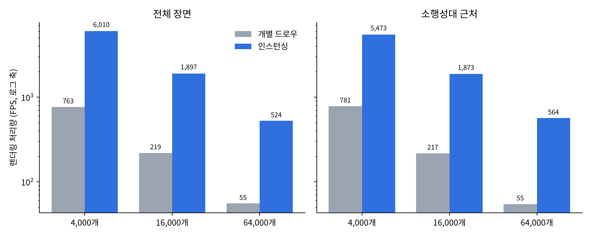

<h1 align="center">3D Solar System Simulator</h1>

<p align="center">C++20과 OpenGL로 만든 3D 태양계 시뮬레이션</p>

<p align="center">
  
  
  
</p>



## Contents

* [프로젝트 소개](#프로젝트-소개)
* [자전과 공전의 변환 순서](#자전과-공전의-변환-순서)
* [소행성의 노멀 매핑](#소행성의-노멀-매핑)
* [소행성대 인스턴싱](#소행성대-인스턴싱)
* [빌드 및 실행](#빌드-및-실행)

## 프로젝트 소개

부경대학교 컴퓨터그래픽스 수업에서 배운 변환과 텍스처링을 적용해 만든 태양계 시뮬레이션입니다. 태양과 여덟 행성이 각자의 속도로 자전하고 공전하며, 화성과 목성 사이에는 소행성대가 돕니다. 카메라를 움직여 행성 표면, 토성 고리, 소행성대를 가까이 볼 수 있고, 시간 진행 속도를 바꿔 자전과 공전의 차이를 관찰할 수 있습니다. 행성 사이의 거리는 로그로 압축하고 작은 행성에는 최소 크기를 두었으므로, 화면의 축척은 실제 태양계와 다릅니다.


행성은 태양을 향한 면만 밝고 반대편은 어둡습니다. 태양이 원점에 있으므로 표면 법선과 태양 방향의 내적으로 밝기를 정합니다.

<p align="center">
  
  
</p>

토성 고리는 알파 블렌딩으로 배경이 비쳐 보이게 했고, 태양의 광채는 가산 블렌딩으로 이미 그려진 색에 빛을 더합니다. 광채와 궤도선은 깊이 검사는 하되 깊이를 기록하지 않아서, 나중에 그리는 행성을 가리지 않습니다.

## 자전과 공전의 변환 순서

모든 행성은 하나의 단위 구 메시를 공유하고, 모델 행렬과 텍스처만 다르게 적용합니다. 자전과 공전은 둘 다 Y축 회전이지만 회전의 중심이 다릅니다. 자전은 행성 자신의 중심에서, 공전은 태양을 중심으로 돌아야 합니다. 그래서 같은 회전 함수를 쓰되 이동 행렬의 앞과 뒤에 나눠 곱했습니다.

```cpp
const Mat4 model = RotateZ(-planet.revolutionTilt)             // 궤도면 기울기
                 * RotateY(planet.revolutionSpeed * g_days)    // 태양을 중심으로 공전
                 * Translate({ distance, 0.f, 0.f })           // 궤도 위치로 이동
                 * RotateZ(-planet.rotationTilt)               // 자전축 기울기
                 * RotateY(planet.rotationSpeed * g_days);     // 행성 중심에서 자전
```

정점에는 오른쪽 행렬부터 적용됩니다. 원점에 있는 구를 먼저 자전시키고 자전축을 기울인 뒤 궤도 위치로 옮기므로, 그다음의 회전은 태양을 중심으로 한 공전이 됩니다. 이동 행렬의 오른쪽에 있는 회전은 자전, 왼쪽에 있는 회전은 공전입니다. 행렬, `LookAt()`, `Perspective()`는 라이브러리 없이 직접 구현했습니다.

구의 텍스처 좌표는 경도를 U, 위도를 V로 대응시켰습니다. 경도가 한 바퀴 도는 지점에는 위치가 같은 정점을 두 개 두고 U를 각각 0과 1로 줍니다. 정점을 하나만 두면 마지막 열의 삼각형에서 U가 1에 가까운 값부터 0까지 거꾸로 보간되어, 텍스처 전체가 좁은 띠에 압축된 이음매가 생기기 때문입니다.

## 소행성의 노멀 매핑


소행성은 외부 바위 모델을 쓰고, 표면의 작은 요철은 삼각형을 늘리지 않고 노멀 맵으로 표현했습니다. 두 바위의 형태는 같고 외곽선도 같지만, 오른쪽은 픽셀마다 법선이 달라져 요철이 빛을 받습니다.

노멀 맵의 법선은 표면의 UV 방향을 축으로 하는 탄젠트 공간의 값이라서, 월드 공간으로 옮기려면 정점마다 탄젠트가 필요합니다. OBJ 파일에는 탄젠트가 없으므로 [`LoadObjMesh()`](main.cpp)에서 삼각형의 두 변과 UV 차이로 직접 계산합니다.

```cpp
const float area      = du1 * dv2 - du2 * dv1;
const Vec3  tangent   = (edge1 * dv2 - edge2 * dv1) * (1.f / area);
const Vec3  bitangent = (edge2 * du1 - edge1 * du2) * (1.f / area);
```

정점을 공유하는 삼각형들의 탄젠트를 더한 뒤 법선 성분을 빼고 정규화합니다. 바이탄젠트는 저장하지 않고 `cross(N, T)`와 방향이 같은지만 부호로 남겨, 셰이더에서 다시 만듭니다.

같은 바위가 반복되어 보이지 않도록 소행성마다 축별 크기를 다르게 줬는데, 이 때문에 법선 처리가 하나 더 필요했습니다. X축으로만 늘린 바위에서 위치처럼 법선에도 X 크기를 곱하면, 법선이 늘어난 방향으로 기울어 표면과 수직이 아니게 됩니다. 위치에는 크기를 곱하고, 법선에는 크기로 나눠야 수직이 유지됩니다.

```glsl
vec3 normal  = normalize(rotation * (aNormal / aScale.xyz));
vec3 tangent = normalize(rotation * (aTangent.xyz * aScale.xyz));
tangent      = normalize(tangent - dot(tangent, normal) * normal);
```

탄젠트는 표면 위의 방향이므로 위치처럼 크기를 곱하고, 법선과 다시 수직이 되도록 보정합니다.

## 소행성대 인스턴싱


소행성대에 소행성 10만 개를 그리는 것이 목표였습니다. 처음에는 소행성마다 값을 설정하고 `glDrawElements`를 한 번씩 호출했는데, 10만 개에서 프레임당 28.6 ms(35 FPS)가 걸렸습니다.

모든 소행성은 같은 메시와 텍스처를 쓰고 궤도, 자전, 크기만 다릅니다. 시간을 매 프레임 CPU에서 갱신할 필요도 없습니다. 궤도 반지름, 초기 각도, 각속도처럼 시간에 따라 변하지 않는 값만 저장해 두면, 셰이더가 경과 일수 `uDays`로 현재 위치를 계산할 수 있습니다. 그래서 소행성마다 다른 값을 `vec4` 세 개로 묶어 GPU 버퍼에 한 번 올리고, 인스턴싱으로 그렸습니다.

<table width="100%">
  <thead>
    <tr>
      <th align="left">속성</th>
      <th align="left">값</th>
    </tr>
  </thead>
  <tbody>
    <tr>
      <td><code>aOrbit</code></td>
      <td>궤도 반지름, 높이, 초기 공전 각도, 공전 각속도</td>
    </tr>
    <tr>
      <td><code>aSpin</code></td>
      <td>자전축 xyz, 자전 각속도</td>
    </tr>
    <tr>
      <td><code>aScale</code></td>
      <td>축별 크기 xyz, 초기 자전 각도</td>
    </tr>
  </tbody>
</table>

인스턴스 버퍼를 VAO의 바인딩 슬롯 1에 연결하고 divisor를 1로 설정하면, 이 슬롯의 속성은 정점마다가 아니라 인스턴스마다 다음 값으로 넘어갑니다. 드로우 호출은 개수와 관계없이 한 번입니다.

```cpp
glVertexArrayVertexBuffer(_mesh.vao, 1, g_asteroidInstanceBuffer, 0, kAsteroidStride * static_cast<GLsizei>(sizeof(float)));
glVertexArrayBindingDivisor(_mesh.vao, 1, 1);

glDrawElementsInstanced(mesh.mode, mesh.count, GL_UNSIGNED_INT, nullptr, g_asteroidCount);
```

```glsl
mat3  rotation = AxisAngle(aSpin.xyz, aScale.w + aSpin.w * uDays);
float angle    = aOrbit.z + aOrbit.w * uDays;
vec3  center   = vec3(aOrbit.x * cos(angle), aOrbit.y, -aOrbit.x * sin(angle));

vWorldPosition = center + rotation * (aPosition * aScale.xyz);
```

### 측정



같은 장면에서 드로우 방식만 바꿔 소행성 1,000개, 1만 개, 10만 개를 그렸습니다. 개별 드로우도 셰이더와 데이터는 같고, 인스턴스 속성 대신 상수 속성(`glVertexAttrib4fv`)으로 값을 넘긴 뒤 소행성마다 `glDrawElements`를 호출합니다. 드로우 호출 비용만 보도록 정점 42개짜리 저폴리 바위를 썼고, 1920×1080에서 VSync와 화면 표시를 빼고 쟀습니다. 조건마다 0.5초 예열 뒤 1.5초를 측정했고, 두 방식의 순서를 바꿔 2회 반복했습니다. 두 방식이 같은 그림을 그리는지 픽셀을 비교했고, 채널 차이는 최대 1/255였습니다. 측정 환경은 Ryzen 9 7945HX, RTX 4060 Laptop GPU입니다.

<table width="100%">
  <thead>
    <tr>
      <th align="right">소행성 수</th>
      <th align="right">개별 드로우</th>
      <th align="right">인스턴싱</th>
      <th align="right">배율</th>
      <th align="right">CPU 제출 시간</th>
    </tr>
  </thead>
  <tbody>
    <tr>
      <td align="right">1,000</td>
      <td align="right">0.378 ms</td>
      <td align="right">0.076 ms</td>
      <td align="right">5.0배</td>
      <td align="right">0.37 ms → 0.04 µs</td>
    </tr>
    <tr>
      <td align="right">10,000</td>
      <td align="right">3.00 ms</td>
      <td align="right">0.346 ms</td>
      <td align="right">8.7배</td>
      <td align="right">2.99 ms → 0.09 µs</td>
    </tr>
    <tr>
      <td align="right">100,000</td>
      <td align="right">28.6 ms</td>
      <td align="right">3.00 ms</td>
      <td align="right">9.5배</td>
      <td align="right">28.52 ms → 0.14 µs</td>
    </tr>
  </tbody>
</table>

프레임 시간은 전체 장면 시점의 FPS를 역수로 바꾼 값입니다. 10만 개에서 28.6 ms → 3.00 ms(35.0 → 333.4 FPS), 약 9.5배 빨라졌습니다.

개별 드로우에서는 CPU가 드로우 명령을 보내는 시간이 프레임 시간과 거의 같았습니다. 명령 하나마다 드라이버가 상태를 확인하고 명령을 만드는 비용이 소행성 수만큼 쌓였고, GPU는 그 명령을 기다렸습니다. 인스턴싱은 명령을 한 번만 보내므로 CPU 제출 시간이 마이크로초 이하로 줄고, 프레임 시간은 GPU가 실제로 그리는 시간만 남습니다. 소행성 수가 늘수록 배율이 커지는 것도 줄어든 비용이 개수에 비례하기 때문입니다. 측정 코드와 원본 결과는 [`Docs/InstancingBenchmark`](Docs/InstancingBenchmark)에 있습니다.

## 빌드 및 실행

Windows에서 C++20으로 빌드합니다. Visual Studio 2026(플랫폼 도구 집합 `v145`)의 "C++를 사용한 데스크톱 개발" 워크로드와 OpenGL 4.6을 지원하는 그래픽 드라이버가 필요합니다. glew와 stb는 `vcpkg.json`으로 설치됩니다.

1. 저장소를 받습니다.

   ```powershell
   git clone https://github.com/JuggernautSensei/3D-Solar-System-Simulator.git
   ```

2. `SolarSystem.sln`을 Visual Studio로 엽니다.
3. 구성을 `Release | x64`로 두고 빌드한 뒤 실행합니다(`Ctrl+F5`).

<table width="100%">
  <thead>
    <tr>
      <th align="left">동작</th>
      <th align="left">키</th>
    </tr>
  </thead>
  <tbody>
    <tr>
      <td>시점 회전</td>
      <td>마우스</td>
    </tr>
    <tr>
      <td>카메라 이동 (앞, 뒤, 왼쪽, 오른쪽, 아래, 위)</td>
      <td>W, S, A, D, Q, E</td>
    </tr>
    <tr>
      <td>카메라 이동 속도 줄이기, 늘리기</td>
      <td>O, P</td>
    </tr>
    <tr>
      <td>시간 진행 속도 늘리기, 줄이기</td>
      <td>K, L</td>
    </tr>
    <tr>
      <td>누르는 동안 시간 가속</td>
      <td>Space</td>
    </tr>
    <tr>
      <td>소행성 4,000개, 1만 개, 5만 개, 10만 개</td>
      <td>1, 2, 3, 4</td>
    </tr>
    <tr>
      <td>인스턴싱 켜기, 끄기</td>
      <td>I</td>
    </tr>
    <tr>
      <td>성능 표시 켜기, 끄기</td>
      <td>H</td>
    </tr>
    <tr>
      <td>종료</td>
      <td>Esc</td>
    </tr>
  </tbody>
</table>
