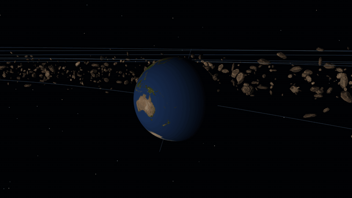
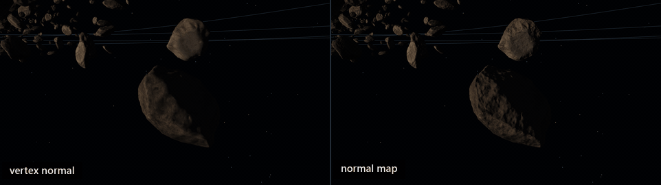
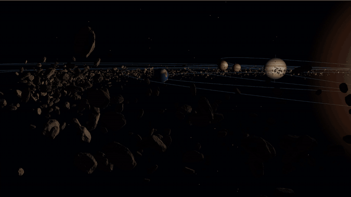

<h1 align="center">3D Solar System Simulator</h1>

<p align="center">C++20과 OpenGL로 만든 3D 태양계 시뮬레이션</p>

<p align="center">
  
  
  
</p>

<p align="center"></p>

## Contents

- [프로젝트 소개](#프로젝트-소개)
- [자전과 공전의 변환 순서](#자전과-공전의-변환-순서)
- [조명과 블렌딩](#조명과-블렌딩)
- [소행성의 노멀 매핑](#소행성의-노멀-매핑)
- [소행성대 인스턴싱](#소행성대-인스턴싱)
- [빌드 및 실행](#빌드-및-실행)

## 프로젝트 소개

부경대학교 컴퓨터그래픽스 수업에서 배운 변환과 텍스처링을 적용해 만든 태양계 시뮬레이션입니다. 카메라와 시간 진행 속도를 조절해 행성의 자전과 공전을 관찰할 수 있습니다. 한 화면에서 궤도를 비교하고 작은 행성도 볼 수 있도록 거리를 로그로 압축하고 행성 크기에 최솟값을 뒀습니다.

- 행렬, `LookAt()`, `Perspective()`를 직접 구현하고, 변환 순서로 자전과 공전을 함께 표현했습니다.
- 토성 고리는 알파 블렌딩, 태양 광채는 가산 블렌딩으로 그립니다.
- 소행성은 노멀 매핑으로 표면 요철을 표현하고, 인스턴싱으로 최대 10만 개를 드로우 콜 한 번에 그립니다. 10만 개에서 프레임 시간이 28.6 ms에서 3.00 ms로 줄었습니다.

## 자전과 공전의 변환 순서

태양과 행성은 단위 구 메시 하나를 공유하고, 크기·텍스처·모델 행렬을 다르게 적용합니다. 자전은 행성 중심에서, 공전은 태양이 놓인 원점에서 일어납니다. 회전 중심을 바꾸기 위해 두 회전 행렬 사이에 이동 행렬을 둡니다.

```cpp
const Mat4 model = RotateZ(-planet.revolutionTilt)
                 * RotateY(planet.revolutionSpeed * g_days)
                 * Translate({ distance, 0.f, 0.f })
                 * RotateZ(-planet.rotationTilt)
                 * RotateY(planet.rotationSpeed * g_days);
```

정점에는 오른쪽 행렬부터 적용됩니다. 구를 자전시키고 자전축을 기울인 뒤 태양에서 떨어진 위치로 옮깁니다. 그 위치를 원점 주위로 회전시키면 공전이 되고, 마지막에 궤도면을 기울입니다. 구의 텍스처는 경도와 위도에 맞춰 입히고, 경도 양 끝에는 위치가 같은 정점에 U를 각각 0과 1로 줘 이음매에서 텍스처가 잘못 보간되는 것을 막았습니다. 모델·뷰·투영 행렬 계산도 직접 구현했습니다. [시뮬레이션 코드](main.cpp)

## 조명과 블렌딩

행성 표면의 법선과 태양 방향의 내적으로 직사광의 세기를 구합니다. 아래 지구처럼 태양을 향한 쪽은 밝고, 반대쪽에는 약한 환경광만 남습니다.



토성 고리는 알파 블렌딩으로 배경이 비치게 하고, 태양 광채는 가산 블렌딩으로 주변을 밝힙니다. 궤도선과 광채는 깊이 검사만 수행해 나중에 그리는 행성을 가리지 않습니다.

<p align="center">
  
  
</p>

## 소행성의 노멀 매핑



소행성 표면의 작은 요철은 노멀 맵으로 표현했습니다. 오른쪽 바위는 외곽선이 같은데도 픽셀마다 빛을 받는 방향이 달라 표면에 굴곡이 보입니다.

노멀 맵에서 읽은 방향을 월드 공간으로 옮기려면 표면의 탄젠트와 바이탄젠트가 필요합니다. OBJ 로더는 삼각형의 변과 UV 차이로 탄젠트를 구해 정점마다 모으고, 법선에 수직이 되도록 보정합니다. 바이탄젠트 방향은 부호로 저장하고 셰이더에서 외적으로 복원합니다.

같은 메시를 축마다 다른 크기로 늘려 소행성의 형태에 변화를 줬습니다. 이때 셰이더는 위치와 탄젠트에는 축별 크기를 곱하고, 법선은 축별 크기로 나눕니다. 이렇게 변환한 법선은 비균일하게 늘어난 표면과 수직을 이룹니다.

## 소행성대 인스턴싱



소행성은 메시와 텍스처를 공유합니다. 궤도 반지름과 초기 각도, 각속도처럼 개체마다 다른 값은 GPU 버퍼에 한 번 올리고, 매 프레임에는 경과 일수만 넘깁니다. 정점 셰이더가 이 값으로 현재 공전 위치와 자전을 계산합니다.

| 인스턴스 속성 | 저장한 값 |
| --- | --- |
| `aOrbit` | 궤도 반지름, 높이, 초기 공전 각도, 공전 각속도 |
| `aSpin` | 자전축, 자전 각속도 |
| `aScale` | 축별 크기, 초기 자전 각도 |

속성의 divisor를 1로 설정해 정점마다 같은 값을 사용하고, 다음 소행성에서 새 값으로 넘어가게 했습니다. 정점 셰이더는 이 값과 경과 일수로 현재 위치를 계산합니다.

```glsl
mat3  rotation = AxisAngle(aSpin.xyz, aScale.w + aSpin.w * uDays);
float angle    = aOrbit.z + aOrbit.w * uDays;
vec3  center   = vec3(aOrbit.x * cos(angle), aOrbit.y, -aOrbit.x * sin(angle));

vWorldPosition = center + rotation * (aPosition * aScale.xyz);
```

개별 드로우에서는 소행성마다 속성을 넘기고 `glDrawElements`를 호출합니다. 인스턴싱에서는 `glDrawElementsInstanced` 한 번으로 소행성대를 제출합니다.

### 성능 비교

같은 카메라·셰이더·소행성 데이터로 두 드로우 방식을 비교했습니다. 드로우 호출 비용을 보기 위해 정점 42개짜리 저폴리 바위를 썼고, RTX 4060 Laptop GPU, 1920×1080에서 측정했습니다.

| 소행성 수 | 개별 드로우 프레임 시간 | 인스턴싱 프레임 시간 | 처리량 배율 |
| ---: | ---: | ---: | ---: |
| 1,000 | 0.378 ms | 0.076 ms | 5.0배 |
| 10,000 | 3.00 ms | 0.346 ms | 8.7배 |
| 100,000 | 28.6 ms | 3.00 ms | 9.5배 |

개별 드로우에서는 CPU가 드로우 명령을 보내는 시간이 프레임 시간과 거의 같았습니다. 10만 개 기준 CPU 제출 시간은 28.52 ms에서 0.14 µs로 줄었고, 소행성이 많을수록 배율이 커집니다. 측정 조건과 재현 방법은 [벤치마크 보고서](Docs/InstancingBenchmark/measurement-report.md)에 있습니다.

## 빌드 및 실행

Windows에서 Visual Studio 2026의 ‘C++를 사용한 데스크톱 개발’ 워크로드와 플랫폼 도구 집합 `v145`, OpenGL 4.6을 지원하는 그래픽 드라이버가 필요합니다. Visual Studio의 vcpkg 구성 요소를 설치하면 빌드할 때 매니페스트에 지정된 GLEW와 stb를 가져옵니다.

1. 저장소를 받습니다.

   ```powershell
   git clone https://github.com/JuggernautSensei/3D-Solar-System-Simulator.git
   ```

2. `SolarSystem.sln`을 Visual Studio에서 엽니다.
3. `Release | x64`로 빌드한 뒤 `Ctrl+F5`로 실행합니다.

| 동작 | 키 |
| --- | --- |
| 시점 회전 | 마우스 |
| 카메라 이동 | `W` / `S` 앞뒤, `A` / `D` 좌우, `Q` / `E` 아래위 |
| 카메라 이동 속도 줄이기 / 늘리기 | `O` / `P` |
| 시간 진행 속도 줄이기 / 늘리기 | `L` / `K` |
| 누르는 동안 시간 가속 | `Space` |
| 소행성 수 전환 | `1` / `2` / `3` / `4` (4천 / 1만 / 5만 / 10만 개) |
| 인스턴싱 켜기 / 끄기 | `I` |
| 성능 표시 켜기 / 끄기 | `H` |
| 종료 | `Esc` |
