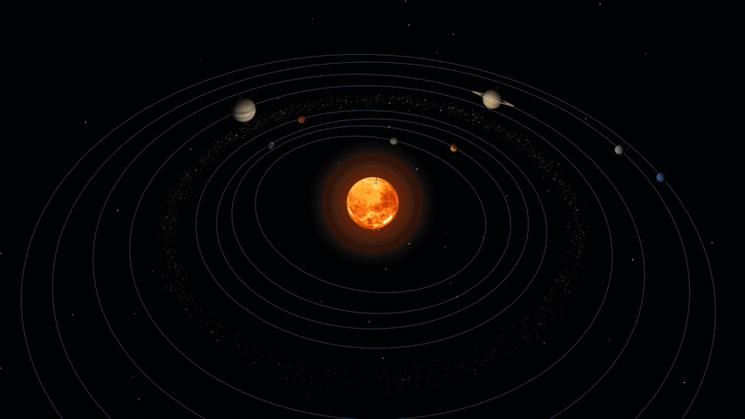
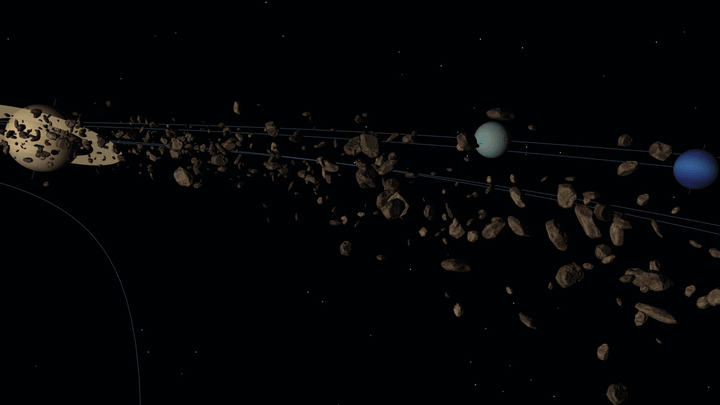
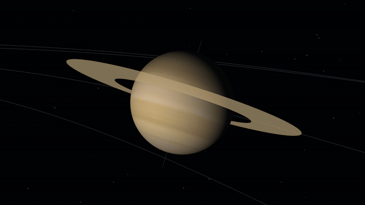

<div align="center">

# 3D Solar System Simulator

**OpenGL 4.6 Core로 만든 실시간 태양계 렌더러**


</div>

<p align="center"></p>

<br>

## 개요

Win32 API와 OpenGL 4.6 Core 프로필로 만든 태양계 렌더러입니다. 태양과 행성 8개, 소행성 4,000개를 GLSL 셰이더로 그립니다. 외부 라이브러리는 확장 함수 로딩(GLEW)과 이미지 디코딩(stb_image)만 쓰고, 행렬 연산과 OBJ 로딩은 직접 구현했습니다.

<br>

## 셰이더와 조명

<p align="center"></p>

셰이더는 GLSL 460으로 작성했고, 프로그램은 행성·소행성·별·태양 광채·선 그리기용으로 5개입니다. 유니폼 위치를 `layout(location = N)`으로 고정해 두고 `glProgramUniform*`으로 값을 넣습니다.

광원은 원점에 있는 태양 하나입니다. 프래그먼트 셰이더에서 픽셀마다 램버트 확산광을 계산합니다.

```glsl
float diffuse = max(dot(normalize(vNormal), normalize(-vWorldPosition)), 0.0);   // 태양 방향 = 원점 - 위치
oColor        = vec4(albedo.rgb * (kAmbient + kSunlight * diffuse), albedo.a);
```

행성 메시는 원점 중심의 단위 구라서 정점 위치가 곧 법선입니다. 그래서 법선을 따로 저장하지 않고 `mat3(uModel) * aPosition`으로 구합니다.

<br>

## 텍스처 매핑

<p align="center"></p>

텍스처는 stb_image로 읽어 DSA로 올립니다. `glTextureStorage2D`로 밉맵 단계까지 한 번에 할당하고, `glGenerateTextureMipmap`으로 채웁니다.

```cpp
const auto levels = static_cast<GLsizei>(std::bit_width(static_cast<unsigned>(std::max(width, height))));   // floor(log2) + 1
glCreateTextures(GL_TEXTURE_2D, 1, &texture);
glTextureStorage2D(texture, levels, GL_RGBA8, width, height);
glTextureSubImage2D(texture, 0, 0, 0, width, height, GL_RGBA, GL_UNSIGNED_BYTE, pixels);
glGenerateTextureMipmap(texture);
```

구의 UV는 경도와 위도를 그대로 [0, 1]로 옮겨 만듭니다. 경도 0°와 360° 정점을 따로 두어서, 이음매에서 UV가 1에서 0으로 넘어가며 생기는 줄무늬를 막았습니다.

<br>

## 노멀 매핑

<p align="center"></p>

왼쪽은 정점 법선만 쓴 바위, 오른쪽은 같은 바위에 노멀 맵을 적용한 모습입니다.

소행성 모델(`Rock1.obj`)은 직접 만든 OBJ 로더로 읽습니다. OBJ에는 탄젠트가 없어서, 삼각형마다 두 변과 UV 차이로 탄젠트를 구해 정점에 누적합니다.

```cpp
const float area    = du1 * dv2 - du2 * dv1;                    // UV 삼각형의 면적(부호 포함)
const Vec3  tangent = (edge1 * dv2 - edge2 * dv1) * (1.f / area);
```

바이탄젠트는 저장하지 않습니다. 방향(±1)만 탄젠트의 w에 담아 두었다가, 정점 셰이더에서 `cross(N, T) * w`로 복원합니다. 프래그먼트 셰이더는 노멀 맵 값을 이 TBN 행렬로 월드 공간에 옮겨 조명을 계산합니다.

<br>

## 인스턴싱

<p align="center"></p>

소행성 4,000개는 바위 메시 하나를 같이 씁니다. 개체마다 다른 궤도, 자전축, 크기는 인스턴스 버퍼 하나에 담아 시작할 때 한 번만 올리고, VAO의 두 번째 바인딩 슬롯에 디바이저 1로 연결합니다.

위치와 자세는 정점 셰이더가 경과 일수 `uDays` 하나로 계산합니다. CPU는 매 프레임 float 하나를 보내고 `glDrawElementsInstanced`를 한 번 호출합니다.

```glsl
mat3  rotation = AxisAngle(aSpin.xyz, aScale.w + aSpin.w * uDays);   // 자전
float angle    = aOrbit.z + aOrbit.w * uDays;                        // 공전
vec3  center   = vec3(aOrbit.x * cos(angle), aOrbit.y, -aOrbit.x * sin(angle));
vWorldPosition = center + rotation * (aPosition * aScale.xyz);
```

개체마다 상태를 바꿔 4,000번 그리는 방식과 비교하면 CPU 제출 시간은 10배 넘게 줄었지만, GPU 시간은 두 방식 모두 7~8ms로 비슷했습니다. 이 장면의 GPU 비용은 드로우 콜 수가 아니라 삼각형 수(약 1,600만 개)에 따라 정해집니다.

<br>

## 블렌딩

<p align="center">
  
  
</p>

태양 광채는 카메라를 향하는 사각형 하나입니다. 뷰 행렬의 첫 두 행이 카메라의 오른쪽·위쪽 방향이라, 이 두 벡터로 정점을 펼칩니다. 중심에서 멀어질수록 투명해지는 색을 가산 블렌딩(`GL_SRC_ALPHA, GL_ONE`)으로 더합니다.

```glsl
gl_Position = uViewProjection * vec4((uCameraRight * aCorner.x + uCameraUp * aCorner.y) * uRadius, 1.0);
```

토성 고리와 궤도선은 알파 블렌딩으로 그립니다. 궤도선은 깊이 검사만 하고 깊이 버퍼에는 쓰지 않아서, 행성 뒤를 지나는 선이 행성을 가리지 않습니다.

<br>

## 빌드 및 실행

Visual Studio 2026(v145 툴셋)과 vcpkg가 필요합니다. `SolarSystem.sln`을 열고 `Release | x64`로 빌드하면 GLEW와 stb는 vcpkg 매니페스트로 자동 설치됩니다.

마우스로 시점을 돌리고 W/A/S/D/Q/E로 이동합니다.

<br>

## 라이선스

학습 목적의 프로젝트입니다. 행성 텍스처와 바위 모델의 저작권은 각 원작자에게 있습니다.
