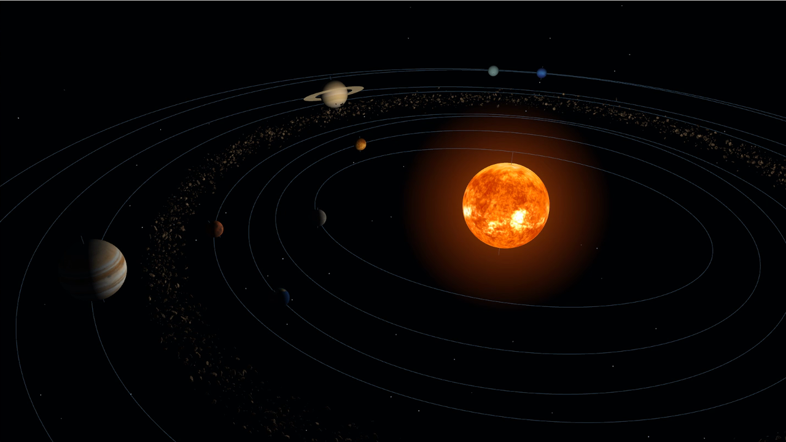
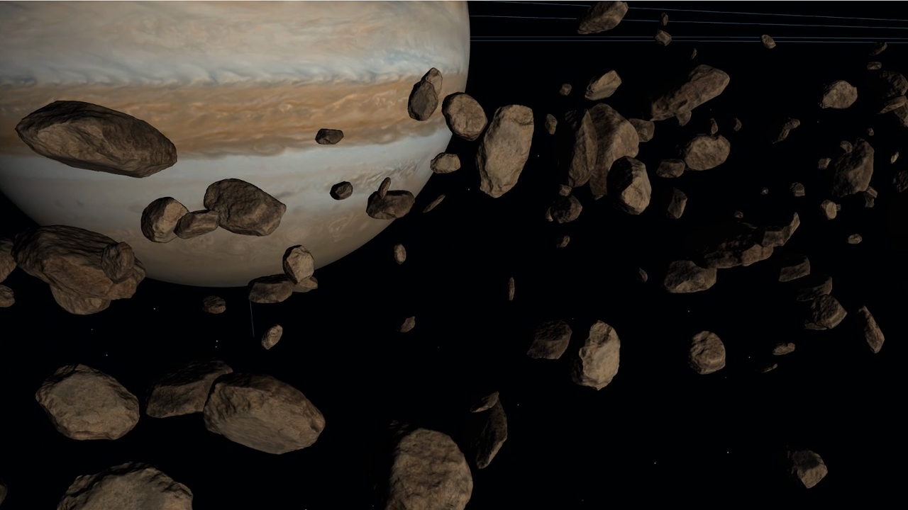
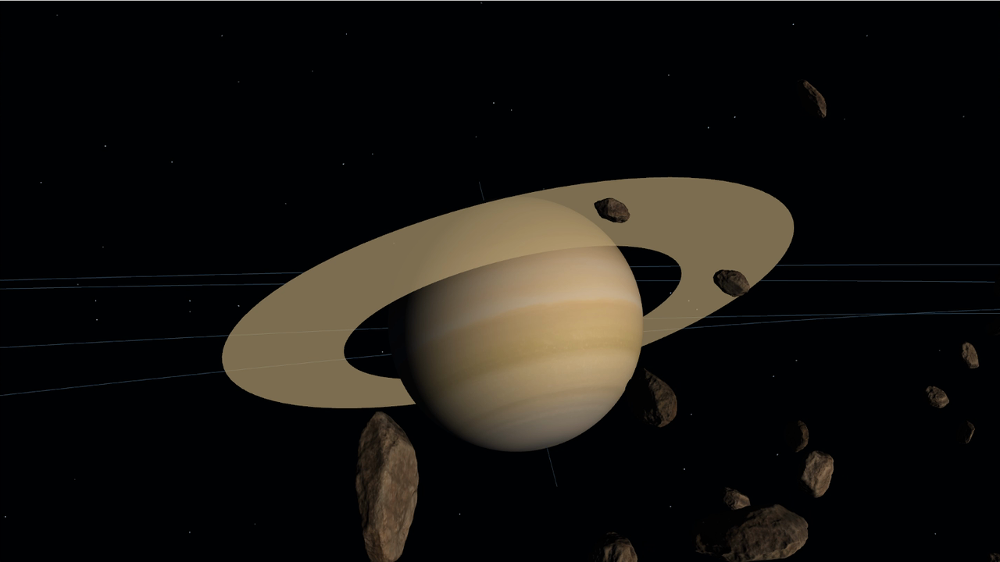
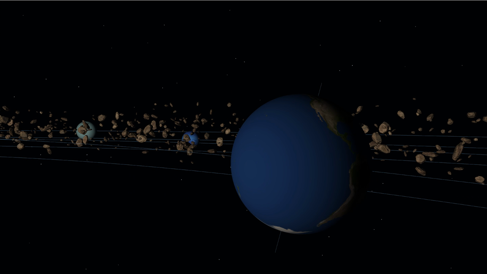
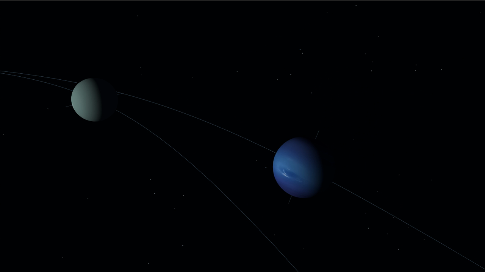
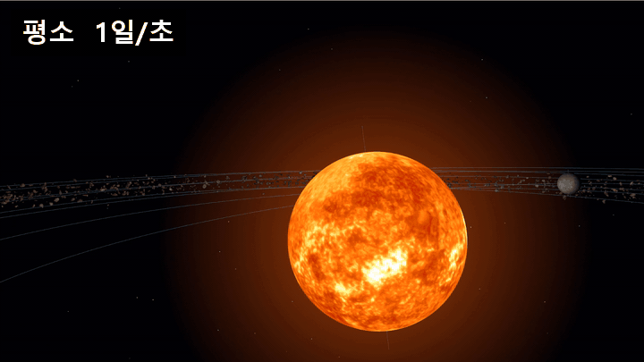
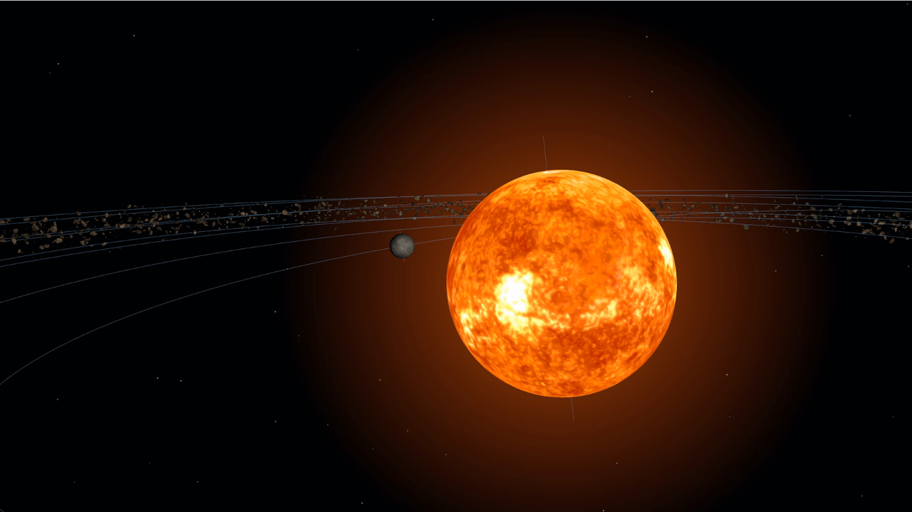
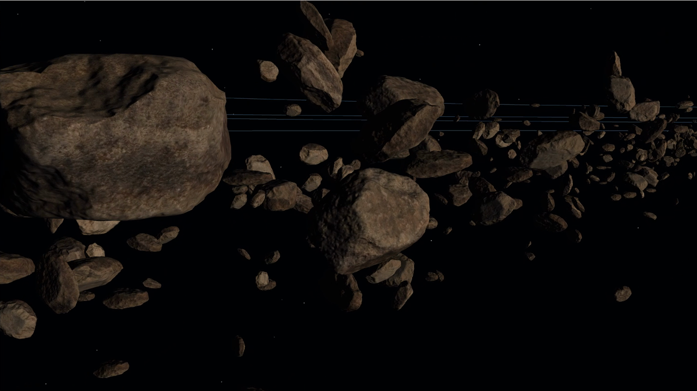

<div align="center">

# 3D Solar System Simulator

**OpenGL 4.6 Core로 그린, 날아다니며 둘러보는 태양계**


[프로젝트 소개](#프로젝트-소개) · [시뮬레이터 소개](#시뮬레이터-소개) · [코드 둘러보기](#코드-둘러보기) · [OpenGL 4.6 Core로 다시 쓰기](#1-glut에서-opengl-46-core로-다시-쓰기) · [카메라](#2-카메라를-다시-만들기) · [소행성대와 인스턴싱](#3-소행성-4000개를-드로우-콜-한-번으로) · [빌드 및 실행](#빌드-및-실행) · [회고](#회고)

</div>

<p align="center"></p>

<p align="center"><a href="Docs/Highlight.mp4">하이라이트 영상 (60초)</a></p>

<br>

## 프로젝트 소개

3D Solar System Simulator는 태양과 여덟 행성, 화성과 목성 사이의 소행성대를 실시간으로 그리는 프로그램입니다. 마우스로 시점을 돌리고 키보드로 우주 공간을 날아다니며 행성을 가까이에서 볼 수 있습니다. 행성은 실제 공전·자전 주기와 기울기를 따라 움직이고, Space를 누르고 있으면 시간이 세 배로 빨리 흐릅니다.

처음 버전은 GLUT 창에 `glBegin`/`glEnd`와 고정 기능 조명으로 그리는 프로그램이었습니다. 이것을 Win32 창과 OpenGL 4.6 Core 컨텍스트, 직접 쓴 셰이더와 DSA(Direct State Access) API로 다시 썼습니다([OpenGL 4.6 Core로 다시 쓰기](#1-glut에서-opengl-46-core로-다시-쓰기)). 그 위에 삼각형 3,998개짜리 바위 모델 4,000개로 소행성대를 만들어, 인스턴싱으로 드로우 콜 한 번에 그립니다. 인스턴싱이 얼마나 도움이 되는지 재 보니, 이 장면의 병목은 드로우 콜 수가 아니라 프레임마다 그리는 삼각형 약 1,600만 개였습니다. 소행성대에 드는 GPU 시간은 그리는 방식과 상관없이 7.1~8.1ms였고, 삼각형만 1/8로 줄이자 0.98ms로 떨어졌습니다([측정](#인스턴싱이-얼마나-도움이-되는지-쟀습니다)).

컴퓨터그래픽스를 공부하면서 고정 파이프라인으로 처음 만들었고, 이후 셰이더 기반으로 다시 쓰면서 카메라와 소행성대를 새로 만들었습니다. 셰이더 파이프라인 전체를 라이브러리 없이 직접 엮어 보는 것이 목표였습니다. 그래서 수학 라이브러리도 쓰지 않고, 필요한 행렬 함수만 직접 만들었습니다.

<br>

## 시뮬레이터 소개

### 둘러보는 흐름

프로그램을 켜면 카메라는 태양계 위쪽 비스듬한 자리(`(0, 68, 73)`, 아래로 43도)에서 태양을 내려다봅니다. 궤도선 여덟 개와 그 사이의 소행성대가 한눈에 들어옵니다. 마우스를 움직이면 시점이 돌고, W를 누르면 바라보는 방향으로 날아갑니다. 소행성대 안으로 들어가면 바위 하나하나가 제각각 다른 축으로 구르면서 태양 주위를 돌고, 목성이나 토성 옆에 멈춰서 자전하는 모습을 볼 수 있습니다.

<p align="center"></p>

<p align="center">
  
  
</p>
<p align="center">
  
  
</p>

### 조작

마우스로 시점을 돌리고, 이동은 바라보는 방향을 기준으로 합니다.

- 마우스: 시점 회전 (위아래는 ±89도까지)
- W / S: 바라보는 방향으로 앞뒤 이동
- A / D: 좌우 이동
- E / Q: 위아래 이동
- P / O: 이동 속도 올리기 / 내리기 (0~50, 처음 15)
- Space (누르는 동안): 시간 3배
- K / L: 기본 시간 흐름 빠르게 / 느리게
- Esc: 종료

창 제목 줄에는 이동 속도, 지금 시간 흐름(하루/초), 시뮬레이션 날짜, FPS가 표시됩니다.

### 시간은 Space를 누르는 동안만 빨라집니다

기본 시간 흐름은 1초에 하루입니다. 수성은 88일에 한 바퀴를 도니까, 가만히 있어도 수성이 태양 주위를 움직이는 게 보입니다. Space를 누르고 있으면 1초에 사흘이 흐르고, 떼면 원래대로 돌아옵니다. 아래 GIF는 카메라를 멈춰 둔 채 Space를 누르기 전부터 누른 뒤까지 이어지는 장면입니다. 누른 뒤부터 수성이 태양 뒤를 훨씬 빨리 지나갑니다.

<p align="center"></p>

가속은 켜고 끄는 방식이 아니라 누르는 동안만 걸립니다. 손을 떼면 바로 원래 속도로 돌아오니, 둘러보다가 행성 배치만 잠깐 바꾸고 싶을 때 쓰기 좋습니다. 원래 Space는 카메라 상승 키였는데, 가속에 Space를 주면서 상승·하강은 E/Q로 옮겼습니다.

### 거리와 크기는 그대로 쓰지 않았습니다

실제 비율로 그리면 아무것도 보이지 않습니다. 해왕성은 수성보다 태양에서 75배 멀고, 지구 반지름은 태양의 1/109입니다. 그래서 거리는 지구 거리를 8로 둔 뒤 로그로 압축했습니다.

```cpp
float ToDisplayDistance(const float _distance)
{
    return _distance > 0.f ? 5.f + std::log2(1.f + _distance) * 4.f : 0.f;   // 태양은 0
}
```

| 천체 | 실제 거리 (AU) | 코드 속 거리 (AU × 8) | 화면 거리 |
|---|---:|---:|---:|
| 수성 | 0.4 | 3.2 | 13.3 |
| 지구 | 1.0 | 8.0 | 17.7 |
| 화성 | 1.5 | 12.0 | 19.8 |
| 소행성대 | 2.1 ~ 3.3 | 16.8 ~ 26.4 | 21.6 ~ 24.1 |
| 목성 | 5.2 | 41.6 | 26.7 |
| 해왕성 | 30.0 | 240.0 | 36.7 |

수성과 해왕성의 거리 차이가 75배에서 2.8배로 줄어서, 시작 시점 한 화면에 모든 궤도가 들어옵니다. 앞에 더한 5는 태양(반지름 3)과 수성 궤도가 겹치지 않게 하려고 넣었습니다. 대신 바깥 행성 사이의 간격은 실제보다 훨씬 좁아 보입니다.

크기는 지구 반지름을 0.1로 두고 실제 비율을 곱한 뒤 1.6배로 키우되, 0.55보다 작아지지 않게 했습니다. 태양은 실제로 지구의 109배지만 30배로 줄였습니다. 이 최솟값 때문에 수성, 금성, 지구, 화성은 화면에서 모두 같은 크기(0.55)로 보입니다. 멀리서도 보이게 하려고 고른 값이지만, 안쪽 행성끼리의 크기 차이는 잃었습니다.

공전과 자전 속도는 주기 그대로입니다. 지구는 365.26일에 한 바퀴 공전하고 0.997일에 한 바퀴 자전하며, 금성은 자전 속도가 음수라 반대 방향으로 돕니다. 천왕성은 자전축이 82도 기울어 거의 누운 채로 돕니다.

<br>

## 코드 둘러보기

### 파일 구성

```
3D-Solar-System-Simulator
├── main.cpp            프로그램 전체 (약 1,750줄)
├── SolarSystem.sln     Visual Studio 솔루션 (vcpkg 매니페스트 모드)
├── CMakeLists.txt      CMake 빌드 (CMakePresets.json의 x64-debug / x64-release)
├── vcpkg.json          의존성: glew, stb
├── Resources           행성 텍스처 9장, Rock1.obj와 바위 텍스처 2장 (빌드 후 실행 파일 옆으로 복사)
└── Docs                README 이미지, GIF, 하이라이트 영상
```

[`main.cpp`](main.cpp) 하나에 모든 코드가 있고, 구분선 주석으로 영역을 나눴습니다.

<details>
<summary>main.cpp 영역별 역할</summary>

| 영역 | 역할 |
|---|---|
| Window | 창 크기(1920×1080), 4x MSAA, Debug 빌드의 디버그 컨텍스트 플래그 |
| Math | `Vec3`, 열 우선(column-major) `Mat4`, `Translate`·`Scale`·`RotateY`·`RotateZ`·`Perspective`·`LookAt` |
| Planet | 행성 9개의 텍스처, 반지름, 거리, 공전·자전 속도와 기울기, `ToDisplayDistance()` |
| Camera · Time | 카메라 위치와 각도, 경과 일수, 시간 흐름, FPS 집계 |
| Shader | GLSL 460 셰이더 5쌍(행성, 단색, 별, 태양 광채, 소행성)과 컴파일·링크 |
| Mesh | DSA로 VAO·버퍼를 만드는 `CreateMesh()`, 구·고리·궤도·자전축·별·사각형 메시 |
| Asteroid | OBJ 로더, 탄젠트 계산, 소행성 인스턴스 버퍼 |
| Render · Update | `Display()`, 시간 갱신, 키보드·마우스 처리 |
| Resource · Platform | 텍스처 로딩, 리소스 생성·해제, `WindowProc`, WGL 컨텍스트 생성 |

</details>

### 프레임 하나가 처리되는 순서

[`main()`](main.cpp)의 반복문은 쌓인 윈도우 메시지를 모두 처리한 뒤, 한 프레임을 갱신하고 그립니다.

```cpp
while (isRunning)
{
    MSG message = {};
    while (::PeekMessageW(&message, nullptr, 0, 0, PM_REMOVE))   // 입력·크기 변경·종료 메시지
    {
        if (message.message == WM_QUIT)
        {
            isRunning = false;
            break;
        }
        ::TranslateMessage(&message);
        ::DispatchMessageW(&message);
    }

    if (isRunning)
    {
        Update();    // 시간, 키보드, 커서 고정, 창 제목
        Display();   // 그리기 + SwapBuffers
    }
}
```

`GetMessage`처럼 메시지가 올 때까지 기다리지 않고 `PeekMessage`로 확인만 하는 건, 입력이 없어도 행성은 계속 움직여야 하기 때문입니다.

`Update()`의 시간 갱신은 고정 간격으로 합니다. 프레임마다 걸린 시간을 쌓아 두었다가 1/60초가 찰 때마다 날짜를 한 칸(기본 1/60일) 더합니다.

```cpp
g_timeSum += g_deltaTime;
while (g_timeSum >= kDayUpdateInterval)   // 1/60초
{
    g_timeSum -= kDayUpdateInterval;
    g_days += GetDayStep();               // Space를 누르고 있으면 3배
}
```

FPS가 100이든 1,000이든 1초에 흐르는 날짜는 같습니다. 행성의 위치는 매 프레임 `g_days` 하나로 다시 계산하므로, 이전 프레임 위치에 속도를 더해 가며 오차가 쌓이는 일도 없습니다.

[`Display()`](main.cpp)는 그리는 순서에 이유가 있습니다.

1. **별**: 깊이 버퍼에 쓰지 않고 그립니다. 별 900개는 카메라 위치를 기준으로 ±500 범위에 놓여서, 아무리 날아가도 가까워지지 않는 배경이 됩니다.
2. **태양 광채**: 카메라를 정면으로 보는 사각형(빌보드) 하나에 가운데서 멀어질수록 투명해지는 색을 칠하고, 더하기 블렌딩(`GL_SRC_ALPHA, GL_ONE`)으로 겹칩니다. 깊이 버퍼에 쓰지 않기 때문에 뒤에 그리는 태양이 광채에 가려지지 않습니다.
3. **소행성대**: 드로우 콜 한 번.
4. **행성마다**: 궤도선(깊이 버퍼에 쓰지 않음) → 자전축 선 → 구 → 토성이면 고리.

궤도선과 자전축은 반투명이라 깊이 버퍼에 쓰면 그 뒤의 행성이 가려집니다. 그래서 깊이 검사는 하되 쓰지는 않게 해서, 행성 앞을 지나는 선은 행성에 가려지고 뒤를 지나는 선은 행성을 가리지 않게 했습니다.

### 행성 하나의 모델 행렬

행성의 위치와 자세는 회전과 이동 다섯 개를 곱해서 만듭니다.

```cpp
const Mat4 model = RotateZ(-planet.revolutionTilt)                // 궤도면 기울기
                 * RotateY(planet.revolutionSpeed * g_days)       // 공전
                 * Translate({ distance, 0.f, 0.f })              // 궤도 위로 이동
                 * RotateZ(-planet.rotationTilt)                  // 자전축 기울기
                 * RotateY(planet.rotationSpeed * g_days);        // 자전
```

오른쪽부터 읽으면, 원점에서 자전시킨 구를 자전축만큼 기울이고, 궤도 반지름만큼 옮긴 뒤, 태양을 중심으로 공전시키고, 궤도면을 기울입니다. 자전축 기울기를 이동보다 먼저 곱했기 때문에 공전하는 동안에도 자전축은 같은 방향을 향합니다. 지구의 자전축이 늘 북극성 쪽을 보는 것과 같습니다.

행성은 반지름 1짜리 구 메시(100×100 분할, 삼각형 20,000개) 하나를 아홉 번 그리고, 크기는 `Scale(radius)`로 바꿉니다. 조명은 태양 위치(원점)에서 오는 빛 하나뿐이고, 태양 자신은 조명을 끄고 텍스처 색 그대로 그립니다.

<br>

## 1. GLUT에서 OpenGL 4.6 Core로 다시 쓰기

### 처음 버전은 OpenGL이 대신 해 주는 것이 많았습니다

처음 버전은 창과 메인 루프를 GLUT(freeglut)가, 텍스처 로딩을 SOIL이 맡았습니다. 행렬은 `glMatrixMode`·`glRotatef`·`glPushMatrix`로 OpenGL 안의 행렬 스택을 조작했고, 구는 `gluSphere`, 조명은 `GL_LIGHT0`, 궤도선은 `glBegin(GL_LINE_LOOP)`과 정점 256개를 매 프레임 넘겨서 그렸습니다.

짧게 만들기에는 좋았지만, 화면에 무엇이 어떻게 그려지는지 제 코드에는 거의 드러나지 않았습니다. 조명 계산은 드라이버 안에서 정점마다 일어났고, 정점 데이터는 매 프레임 CPU에서 GPU로 다시 넘어갔습니다. 셰이더를 직접 쓰고 버퍼를 직접 관리해 보려고 전체를 다시 썼습니다.

| 역할 | 처음 버전 | 지금 |
|---|---|---|
| 창, 입력, 루프 | GLUT | Win32 API (`CreateWindowEx`, `PeekMessage`, Raw Input) |
| OpenGL 컨텍스트 | GLUT가 만든 호환성 컨텍스트 | `wglCreateContextAttribsARB`로 만든 4.6 Core 컨텍스트 |
| 확장 함수 로딩 | 없음 | GLEW |
| 텍스처 | SOIL | stb_image + `glTextureStorage2D`, `glGenerateTextureMipmap` |
| 행렬 | 고정 기능 행렬 스택, `gluPerspective`, `gluLookAt` | 직접 만든 `Mat4`를 유니폼으로 전달 |
| 구, 원판 | `gluSphere`, `gluDisk` | 시작할 때 한 번 만든 VBO |
| 조명 | `GL_LIGHT0`, 정점 단위 | 프래그먼트 셰이더, 픽셀 단위 |

### 4.6 Core 컨텍스트를 만들려면 컨텍스트가 먼저 있어야 합니다

Core 프로필 컨텍스트는 `wglCreateContextAttribsARB`로 만듭니다. 그런데 이 함수는 확장 함수라서, 주소를 얻으려면 이미 만들어진 OpenGL 컨텍스트가 현재 스레드에 연결되어 있어야 합니다. 4x MSAA 픽셀 포맷을 고르는 `wglChoosePixelFormatARB`도 마찬가지입니다.

그래서 [`LoadWglExtensions()`](main.cpp)는 1×1 크기의 보이지 않는 임시 창에 옛날 방식(`wglCreateContext`)으로 컨텍스트를 하나 만들고, GLEW로 WGL 확장 함수를 불러온 뒤 창과 컨텍스트를 바로 지웁니다. 그다음 진짜 창에서 확장 함수로 픽셀 포맷을 고르고 4.6 Core 컨텍스트를 만듭니다.

```cpp
const std::array contextAttributes = {
    WGL_CONTEXT_MAJOR_VERSION_ARB, 4,
    WGL_CONTEXT_MINOR_VERSION_ARB, 6,
    WGL_CONTEXT_PROFILE_MASK_ARB,  WGL_CONTEXT_CORE_PROFILE_BIT_ARB,
    WGL_CONTEXT_FLAGS_ARB,         kContextFlags,   // Debug 빌드면 WGL_CONTEXT_DEBUG_BIT_ARB
    0
};
g_hGLRC = wglCreateContextAttribsARB(g_hDC, nullptr, contextAttributes.data());
```

창 하나에 픽셀 포맷은 한 번만 정할 수 있어서, 임시 창을 진짜 창으로 다시 쓰지 않고 따로 만듭니다. 4x MSAA 포맷이 없으면 샘플 수 0으로 한 번 더 고릅니다. Debug 빌드에서는 디버그 컨텍스트를 만들고 `glDebugMessageCallback`을 걸어서, 잘못된 API 호출이 있으면 콘솔에 바로 출력되게 했습니다.

### 바인딩하지 않고 객체를 직접 고치는 DSA를 썼습니다

예전 방식은 `glBindBuffer`로 버퍼를 "현재 버퍼"로 걸어 둔 다음 `glBufferData`를 불러야 했습니다. 어떤 버퍼가 걸려 있는지가 전역 상태라서, 다른 함수가 중간에 바인딩을 바꾸면 엉뚱한 버퍼가 고쳐집니다. OpenGL 4.5부터 들어온 DSA는 객체 이름을 인자로 직접 받습니다.

```cpp
glCreateBuffers(1, &mesh.vbo);
glNamedBufferStorage(mesh.vbo, size, data, 0);                       // 바인딩 없이 데이터 업로드

glCreateVertexArrays(1, &mesh.vao);
glVertexArrayVertexBuffer(mesh.vao, 0, mesh.vbo, 0, stride);         // 0번 바인딩 슬롯에 버퍼 연결
glEnableVertexArrayAttrib(mesh.vao, location);
glVertexArrayAttribFormat(mesh.vao, location, size, GL_FLOAT, GL_FALSE, offset);
glVertexArrayAttribBinding(mesh.vao, location, 0);
```

[`CreateMesh()`](main.cpp)는 정점 배열과 속성 크기 목록(`{ 3, 2 }`처럼)만 받아서 위 과정을 대신 해 줍니다. 구, 고리, 궤도, 별, 바위 메시가 모두 이 함수 하나로 만들어집니다. `glNamedBufferStorage`의 마지막 인자를 0으로 둔 건, 이 프로그램의 모든 정점 데이터가 시작할 때 한 번 올라간 뒤 바뀌지 않기 때문입니다. 크기와 용도가 고정된(immutable) 버퍼라고 드라이버에 알려 주는 셈입니다.

유니폼도 같은 이유로 `glUniform*` 대신 `glProgramUniform*`을 씁니다. 셰이더 쪽에서는 `layout(location = N)`으로 유니폼 위치를 정해 두어서, 실행 중에 `glGetUniformLocation`으로 이름을 찾지 않습니다.

### 원래 모습을 셰이더로 옮겼습니다

다시 쓰면서 화면이 달라지지 않게 하는 것도 목표였습니다. 고정 기능 조명의 결과는 "전역 주변광 × 재질 주변광 계수(0.2) + 빛의 색 × 재질 확산광 계수(0.8) × N·L"이라서, 같은 계수를 셰이더 상수로 옮겼습니다.

```glsl
const vec3 kAmbient  = vec3(0.12, 0.14, 0.2) * 0.2;   // 전역 주변광 × 재질 주변광
const vec3 kSunlight = vec3(1.0, 0.94, 0.84) * 0.8;   // 햇빛 × 재질 확산광

float diffuse = max(dot(normalize(vNormal), normalize(-vWorldPosition)), 0.0);   // 태양은 원점
oColor        = vec4(albedo.rgb * (kAmbient + kSunlight * diffuse), albedo.a);
```

달라진 점은 계산 단위입니다. 고정 기능은 정점마다 밝기를 구해 사이를 보간했고, 지금은 픽셀마다 구합니다. 행성의 밝은 쪽과 어두운 쪽 경계가 이전보다 매끄럽습니다.

태양 광채도 원래는 삼각형 팬을 카메라 각도로 대충 돌려서 그렸는데, 지금은 뷰 행렬의 첫 두 행에서 카메라의 오른쪽·위쪽 방향을 꺼내 사각형을 정확히 카메라 쪽으로 세웁니다. 어느 방향에서 다가가도 광채가 납작해지지 않고 둥글게 보입니다.

<p align="center"></p>

<br>

## 2. 카메라를 다시 만들기

다시 쓴 뒤 직접 날아다녀 보니 두 가지가 이상했습니다. 시작 화면의 카메라 위치가 어색했고, 마우스로 시점을 돌리는 조작감도 어딘가 맞지 않았습니다.

### 궤도면이 벽처럼 서 있었습니다

처음 버전은 행성을 Z축 기준으로 공전시켜서 궤도면이 XY 평면이었습니다. 그런데 카메라는 Y축을 위로 두고 XZ 평면에서 움직였습니다. 땅으로 생각한 평면과 궤도면이 서로 수직이었던 셈입니다. 카메라는 궤도면 아래쪽 `(0, -80, 72)`에서 48도 위를 올려다보며 시작했고, Space(당시 상승 키)를 누르면 위로 떠오르는 게 아니라 궤도면을 따라 옆으로 미끄러졌습니다.

카메라를 궤도면에 맞추는 대신 태양계를 카메라의 세계에 맞췄습니다. 궤도면을 XZ 평면으로 눕히고 Y축을 북쪽으로 삼으면, "위"가 궤도면 밖으로 나가는 방향이 되어 직관과 맞습니다. 세계를 X축으로 -90도 돌리는 것과 같아서, 모델 행렬에서는 `RotateZ`(공전·자전)가 `RotateY`로, `RotateY`(기울기)가 `RotateZ(-각도)`로 바뀌고, 구·고리·궤도 메시도 같은 회전을 적용해 만들었습니다. 텍스처가 뒤집히지 않도록 반사가 아닌 회전만 썼습니다. 시작 위치는 태양계 위쪽 `(0, 68, 73)`, 아래로 43도로 바꿔서 태양이 화면 가운데 오게 했습니다.

### 마우스가 실제로 움직인 것보다 많이 돌았습니다

처음 방식은 이랬습니다. `WM_MOUSEMOVE`가 올 때마다 커서가 창 가운데에서 얼마나 떨어져 있는지 재서 그만큼 시점을 돌리고, 프레임 끝에 커서를 가운데로 되돌립니다.

```cpp
// 처음 방식
case WM_MOUSEMOVE:
    g_cameraYaw += (x - g_centerX) * kSensitivity;   // 가운데에서 떨어진 거리 전체를 더함
```

문제는 `WM_MOUSEMOVE`가 한 프레임에 여러 번 올 수 있는데, 커서는 프레임에 한 번만 되돌린다는 점이었습니다. 예를 들어 한 프레임 동안 마우스가 10픽셀 움직이면서 메시지가 3, 6, 10픽셀 지점에서 세 번 오면, 매번 가운데 기준 거리를 더하니 10이 아니라 19만큼 돕니다. 메시지가 몇 번 오는지는 마우스 속도와 프레임 시간에 따라 달라져서, 같은 손놀림에도 도는 양이 매번 달랐습니다. 프로그램을 켤 때 커서가 창 안에 있으면 첫 메시지 하나로 시점이 확 돌아가 버리는 것도 같은 원인이었습니다.

커서 위치로 계산하는 한 이 문제는 계속 남기 때문에, 마우스가 실제로 움직인 양을 받는 Raw Input으로 바꿨습니다. 시작할 때 `RegisterRawInputDevices`로 마우스를 등록하면 `WM_INPUT`이 장치가 보고한 상대 이동량을 그대로 줍니다.

```cpp
case WM_INPUT:
{
    RAWINPUT input = {};
    UINT     size  = sizeof(input);
    if (::GetRawInputData(reinterpret_cast<HRAWINPUT>(_lParam), RID_INPUT, &input, &size, sizeof(RAWINPUTHEADER)) != static_cast<UINT>(-1)
        && input.header.dwType == RIM_TYPEMOUSE
        && !(input.data.mouse.usFlags & MOUSE_MOVE_ABSOLUTE))    // 상대 이동만
    {
        ProcessMouse(input.data.mouse.lLastX, input.data.mouse.lLastY);   // 메시지마다 그 사이의 이동량만
    }
    break;
}
```

메시지가 몇 번 오든 각각은 직전 메시지 이후의 이동량이라, 더하면 정확히 실제 이동량이 됩니다. Raw Input은 `SetCursorPos`로 커서를 옮긴 것은 보고하지 않습니다. 그래서 커서를 창 가운데로 되돌리는 코드는 그대로 두되, 이제는 커서가 창 밖으로 나가지 않게 붙잡는 역할만 합니다. 이제 회전량은 프레임 수나 메시지 수와 상관없이 마우스 이동량 1당 0.1도입니다. 커서를 창 안에 둔 채 프로그램을 켜도 시작 시점이 튀지 않습니다.

### 바라보는 방향으로 날아가게 했습니다

처음에는 W/S가 수평으로만 움직였습니다. 1인칭 게임처럼 땅을 걷는다면 맞는 방식이지만, 아래를 내려다보며 W를 누르면 내려다보는 곳으로 가지 않고 앞으로 미끄러지기만 했습니다. 지금은 W/S를 바라보는 방향(위아래 각도 포함)으로, A/D를 수평 좌우로, E/Q를 세계의 위아래로 움직입니다.

```cpp
Vec3 direction = {};
if (::GetAsyncKeyState('W') & 0x8000) { direction = direction + forward; }
if (::GetAsyncKeyState('D') & 0x8000) { direction = direction + right; }
if (::GetAsyncKeyState('E') & 0x8000) { direction = direction + up; }
// ... S, A, Q는 빼기

if (Dot(direction, direction) > 0.f)
{
    g_cameraPosition = g_cameraPosition + Normalize(direction) * (g_cameraMoveSpeed * g_deltaTime);
}
```

방향 벡터를 다 더한 뒤 정규화하는 건, 예전처럼 축마다 따로 움직이면 W와 D를 같이 눌렀을 때 √2배(약 1.41배) 빨라지기 때문입니다. 기본 이동 속도도 5에서 15로 올렸습니다. 해왕성 궤도 지름이 약 73인데, 5로는 태양계를 가로지르는 데 15초 가까이 걸렸습니다.

<br>

## 3. 소행성 4,000개를 드로우 콜 한 번으로

<p align="center"></p>

### 바위 모델은 직접 만든 OBJ 로더로 읽습니다

바위는 `Resources/Rock1.obj` 하나를 씁니다. 정점 위치 2,001개, 삼각형 3,998개짜리 모델이고, 색 텍스처와 노멀 맵이 따로 있습니다. 라이브러리를 쓰지 않고 [`LoadObjMesh()`](main.cpp)를 직접 만들었습니다.

OBJ의 면은 `위치/UV/법선` 번호 세 개로 정점을 가리키는데, 같은 위치라도 UV가 다르면 다른 정점이어야 합니다(텍스처 이음매가 그렇습니다). 그래서 `"38/1/1"` 같은 토큰 문자열 자체를 키로 `unordered_map`에 넣어, 처음 보는 조합일 때만 새 정점을 만들고 이미 본 조합이면 그 번호를 다시 씁니다. 번호가 범위를 벗어나거나 형식이 다른 토큰이 나오면 어느 토큰인지 출력하고 로딩을 멈춥니다.

노멀 맵을 쓰려면 정점마다 탄젠트(UV의 u가 늘어나는 방향)가 필요한데, OBJ에는 없습니다. 삼각형마다 두 변과 UV 차이로 탄젠트와 바이탄젠트를 구해 꼭짓점에 더해 두고, 마지막에 법선과 수직이 되도록 고친 뒤 정규화합니다. 바이탄젠트는 따로 저장하지 않고, 방향(UV가 뒤집혀 있는지)만 `handedness`에 ±1로 담아 셰이더에서 `cross(normal, tangent) * handedness`로 다시 만듭니다. 마지막으로 모든 위치를 가장 먼 정점 거리로 나눠 반지름 1로 맞춰 두어서, 인스턴스마다 곱하는 크기 값이 곧 화면에서의 크기가 되게 했습니다.

### 위치 계산은 정점 셰이더가 합니다

소행성마다 다른 값은 시작할 때 한 번 정해서 인스턴스 버퍼(12 float × 4,000개 = 192KB)에 올리고, 다시는 바꾸지 않습니다.

| 값 | 정하는 방법 |
|---|---|
| 궤도 반지름 | 평균 2.7AU, 표준편차 0.3AU 정규분포에서 뽑고 2.1~3.3AU로 자른 뒤 `ToDisplayDistance()` |
| 공전 각속도 | 케플러 제3법칙으로 2π / (365.26 × a<sup>1.5</sup>) rad/일. 안쪽 소행성이 더 빨리 돕니다 |
| 높이 | 궤도면에서 표준편차 0.35인 정규분포 |
| 자전 | 무작위 축, 하루 20~120도, 방향도 무작위 |
| 크기 | 0.06 + 0.2 × u³ (u는 0~1 균등). 세제곱이라 작은 바위가 훨씬 많습니다 |
| 찌그러짐 | 축마다 크기에 0.75~1.25배를 따로 곱함 |

같은 모델을 4,000번 쓰는데도 서로 다른 바위처럼 보이는 건 마지막 두 줄 덕분입니다. 축마다 다른 배율을 곱하면 같은 모양도 길쭉하거나 납작해지고, 자전축과 시작 각도가 다르니 같은 면이 같은 방향을 보는 일도 드뭅니다.

<p align="center"></p>

정점 셰이더는 이 값과 유니폼 `uDays`(경과 일수) 하나로 바위의 위치와 자세를 계산합니다.

```glsl
mat3  rotation = AxisAngle(aSpin.xyz, aScale.w + aSpin.w * uDays);    // 자전: 축, 시작 각도 + 속도 × 날짜
float angle    = aOrbit.z + aOrbit.w * uDays;                         // 공전: 시작 위치 + 각속도 × 날짜
vec3  center   = vec3(aOrbit.x * cos(angle), aOrbit.y, -aOrbit.x * sin(angle));

vec3 normal = normalize(rotation * (aNormal / aScale.xyz));           // 크기가 축마다 다르니 법선은 나눔
vWorldPosition = center + rotation * (aPosition * aScale.xyz);
```

CPU는 매 프레임 `uDays` 하나만 보내고 `glDrawElementsInstanced`를 한 번 부릅니다. 바위마다 행렬을 계산하거나 버퍼를 다시 올리는 일이 없습니다. 법선을 크기로 곱하지 않고 나누는 건, 축마다 크기가 다르면 위치와 같은 변환을 법선에 적용했을 때 표면과 수직이 아니게 되기 때문입니다(역전치 행렬을 쓰는 것과 같은 이유입니다).

### 인스턴싱이 얼마나 도움이 되는지 쟀습니다

인스턴싱을 쓰면 빨라진다고 알고 있었지만, 이 장면에서 실제로 얼마나 차이가 나는지는 몰랐습니다. 그래서 그리는 방식만 바꾼 측정용 빌드를 따로 만들어 소행성대를 그리는 데 걸리는 시간을 쟀습니다.

- **인스턴싱**: 지금 방식. `glDrawElementsInstanced` 한 번.
- **드로우 콜 4,000번**: 같은 인스턴스 버퍼를 쓰되 `glDrawElementsInstancedBaseInstance`로 한 개씩 4,000번.
- **오브젝트마다 상태 설정**: 인스턴싱 없이 그리는 흔한 방식을 흉내 낸 것. 인스턴스 속성 배열을 끄고, 바위마다 CPU에서 `glVertexAttrib4fv` 세 번으로 값을 넣은 뒤 `glDrawElements`를 4,000번.
- **삼각형 1/8**: 인스턴싱 그대로, 인덱스 버퍼의 앞 1/8(바위 하나당 약 500개)만 그림. 모양은 깨지고, 삼각형 수의 영향을 보려고만 잰 것입니다.

GPU 시간은 `GL_TIME_ELAPSED` 쿼리로 소행성대를 그리는 부분만 감싸 쟀고, 쿼리 네 개를 돌려 가며 네 프레임 전 결과를 읽어서 결과를 기다리느라 멈추지 않게 했습니다. CPU 시간은 같은 구간의 GL 호출이 돌아오기까지 걸린 시간입니다. 수직 동기화를 끄고, 시작 시점(전경)과 소행성대 안(근경) 두 곳에서 카메라를 고정해, 3초 동안 데운 뒤 10초를 쟀습니다. 각 경우를 두 번씩 재서 평균을 냈습니다.

| 방식 | GPU 시간 (전경) | GPU 시간 (근경) | CPU 시간 (전경) | CPU 시간 (근경) |
|---|---:|---:|---:|---:|
| 인스턴싱 (드로우 콜 1번) | 7.75ms | 8.01ms | 0.03ms | 0.02ms |
| 드로우 콜 4,000번 | 7.77ms | 8.09ms | 0.11ms | 3.05ms |
| 오브젝트마다 상태 설정 + 드로우 콜 4,000번 | 7.12ms | 7.43ms | 0.36ms | 0.50ms |
| 인스턴싱, 삼각형 1/8 | 0.98ms | 1.00ms | 0.004ms | 0.004ms |

소행성대를 빼고 나머지만 그리면 한 프레임이 0.63~0.67ms였습니다. 소행성대가 들어가면 프레임 전체가 7.9~8.3ms가 되니, 시간 대부분이 소행성대에 들어갑니다.

GPU 시간은 그리는 방식을 바꿔도 7.1~8.1ms로 거의 그대로였습니다. 드로우 콜을 4,000번으로 늘려도 GPU가 하는 일은 같은 삼각형 약 1,600만 개(3,998 × 4,000)를 그리는 것이니까요. 반면 삼각형만 1/8로 줄이자 7.75ms가 0.98ms로 약 7.9배 줄어서, 걸리는 시간이 삼각형 수에 거의 비례했습니다. 이 장면의 병목은 드로우 콜이 아니라 삼각형 수였습니다. 멀리서 보면 화면에서 1~2픽셀밖에 안 되는 바위도 삼각형 3,998개를 전부 그리고 있습니다.

인스턴싱의 차이는 CPU 쪽에서 보였습니다. 오브젝트마다 상태를 넣고 그리는 방식은 0.36~0.50ms, 한 번에 그리는 인스턴싱은 0.02~0.03ms로 10배 넘게 차이가 납니다. 다만 프레임이 8ms 가까이 걸리는 상황에서 0.5ms는 작아서, 이 컴퓨터에서는 화면에 보이는 FPS 차이로 이어지지 않았습니다. 바위 수가 훨씬 많거나 CPU가 느린 환경이라면 이 차이가 먼저 드러날 것입니다.

몇 가지는 설명하지 못한 채로 남았습니다. 오브젝트마다 상태를 설정한 경우가 오히려 GPU 시간이 0.6ms쯤 짧았는데, 인스턴스 속성 배열에서 값을 읽는 대신 고정된 속성 값을 쓰기 때문이라고 짐작하지만 확인하지는 않았습니다. 드로우 콜 4,000번 방식의 CPU 시간은 전경에서 0.11ms, 근경에서 3.05ms로 크게 달랐고, 근경 두 번째 측정에서는 프레임 시간도 10ms대로 흔들렸습니다. CPU 시간은 API 호출이 돌아오기까지의 시간이라, 드라이버가 다른 스레드에서 하는 일은 포함되지 않습니다.

> [!NOTE]
> AMD Ryzen 9 7945HX, NVIDIA GeForce RTX 4060 Laptop GPU(드라이버 32.0.16.1714), Windows 11, 1920×1080, 4x MSAA, Release 빌드에서 측정했습니다. 측정용 빌드는 `main.cpp`를 복사해 그리는 부분만 바꾼 것이고, 저장소에는 남기지 않았습니다. 다른 환경에서는 절대값이 달라질 수 있습니다.

<br>

## 빌드 및 실행

Windows 10 또는 11과 Visual Studio 2026(**C++를 사용한 데스크톱 개발** 워크로드, v145 툴셋), vcpkg, 그리고 OpenGL 4.6을 지원하는 그래픽 드라이버가 필요합니다. vcpkg는 Visual Studio에 포함된 것을 쓰거나, 따로 설치한 뒤 `vcpkg integrate install`을 한 번 실행해 두면 됩니다. GLEW와 stb는 vcpkg 매니페스트(`vcpkg.json`)를 통해 처음 빌드할 때 자동으로 설치됩니다.

1. Visual Studio에서 `SolarSystem.sln`을 엽니다.
2. 구성을 `Release`, 플랫폼을 `x64`로 바꿉니다.
3. **Ctrl + F5**로 실행합니다.

빌드가 끝나면 `Resources` 폴더가 실행 파일 옆(`Bin\x64\Release\Resources`)으로 복사되고, 프로그램은 실행 파일 폴더 기준으로 텍스처와 모델을 읽습니다.

CMake로 빌드하려면 환경 변수 `VCPKG_ROOT`에 vcpkg 경로를 지정한 뒤, 개발자 명령 프롬프트에서 다음을 실행합니다.

```bash
cmake --preset x64-release
cmake --build Build/x64-release
```

> [!TIP]
> 내장 GPU와 외장 GPU가 함께 있는 노트북에서는 내장 GPU로 실행되어 느릴 수 있습니다. Windows 설정의 **시스템 > 디스플레이 > 그래픽**에서 `SolarSystem.exe`를 **고성능**으로 지정해 주세요.

Debug 빌드에서는 OpenGL 디버그 컨텍스트를 만들어, 드라이버가 보고하는 오류와 경고를 콘솔 창에 `[OpenGL]`로 출력합니다.

<br>

## 회고

인스턴싱을 붙이면서 당연히 빨라질 거라고 생각했는데, 재 보니 GPU 시간은 거의 그대로였습니다. 병목은 제가 줄이려던 드로우 콜이 아니라, 1~2픽셀짜리 바위에도 삼각형 3,998개를 다 그리는 데 있었습니다. 기법을 적용했다는 것과 그 기법이 이 장면의 문제를 풀었다는 것은 다른 이야기였습니다. 다음에 손댄다면 거리에 따라 삼각형 수가 다른 모델을 고르는 LOD(Level of Detail)와, 화면 밖의 바위를 빼는 컬링부터 해 보고 싶습니다. 둘 다 인스턴스 데이터를 매 프레임 골라 담아야 해서, 컴퓨트 셰이더로 그릴 목록을 만들고 `glDrawElementsIndirect`로 그리는 구조가 될 것 같습니다.

카메라 문제는 코드를 읽어서가 아니라 직접 날아다녀 보고서야 알았습니다. 원인을 따라가 보니 "마우스 메시지는 프레임마다 한 번 온다"는, 코드 어디에도 적혀 있지 않은 가정이 있었습니다. 처음 버전은 GLUT가 입력을 대신 받아 줬기 때문에 이 가정이 깨지는 걸 볼 일이 없었고, 메시지를 직접 받으면서 드러났습니다.

아직 손대지 못한 부분도 있습니다. 코드가 `main.cpp` 하나에 1,750줄 가까이 있어서, 셰이더 문자열과 메시 생성, 창 관리가 한 파일에 섞여 있습니다. 셰이더를 별도 파일로 빼고 창과 렌더러를 나누면 셰이더만 고쳐 다시 불러오는 것도 가능해질 것입니다. 표현 쪽으로는 안쪽 행성 네 개가 최소 크기 때문에 모두 같은 크기로 보이고, 소행성대는 기울기 없이 높이만 흩뜨려 실제보다 납작하며, 행성 사이의 그림자도 없습니다.

GLUT가 대신 해 주던 일을 하나씩 직접 하면서, 화면에 점 하나가 찍히기까지 무엇이 필요한지 처음부터 끝까지 따라가 볼 수 있었던 프로젝트였습니다.

<br>

## 고지

학습 목적으로 만든 프로젝트입니다. 행성 텍스처와 바위 모델(`Rock1.obj`, `tex_low_*`)의 저작권은 각 원작자에게 있습니다. 행성의 공전·자전 주기와 기울기는 [한국천문연구원 천문우주지식정보](https://astro.kasi.re.kr/learning/pageView/5116)를 참고했습니다.
